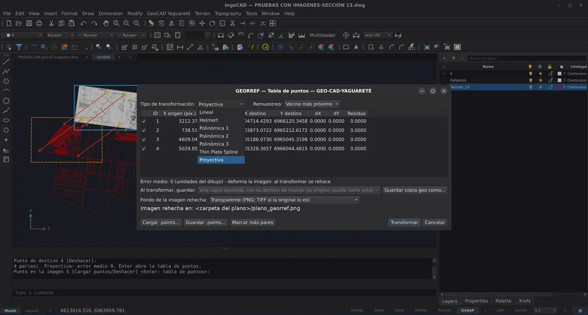
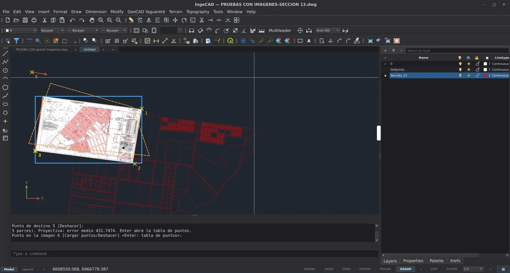

# Georreferenciar una imagen con puntos de control (GEORREF) — guía de uso

Con **GEORREF** (también **RUBBERSHEET** o **AJUSTEIMAGEN**), **GeoCAD
Yaguareté** lleva a su lugar, dentro del dibujo de IngeCAD, un plano
escaneado, una foto aérea o cualquier imagen. Se marcan **pares de puntos**:
dónde está algo en la imagen y dónde tiene que quedar en el dibujo. Funciona
como el **Georreferenciador de QGIS**, con los mismos métodos y el mismo
archivo de puntos (`.points`), y como el RUBBERSHEET de AutoCAD Map.

*Un plano de mensura escaneado sobre las parcelas de la sección. Cada flecha
roja numerada es un par, que va de un punto de la imagen (cruz amarilla) a
su lugar en el dibujo. El punteado naranja muestra dónde va a quedar la
imagen antes de transformarla.*

## Antes de empezar (una sola vez)

1. Activar el módulo: **GeoCAD Yaguareté > Módulos… > Imágenes
   georreferenciadas**.
2. Tener la imagen en el dibujo (**IMAGEATTACH**, **Ctrl+V** /
   **PEGARIMAGEN**, **INSERTARGEO**...) y el dibujo de destino a la vista:
   parcelas, mensuras, ejes de calles, puntos medidos.
3. Encender las referencias a objetos (**REFENT**). Así cada punto cae
   exacto en un vértice, en una intersección o en una esquina del marco de
   la imagen ([guía del marco](IMAGENES.md)).

## Cómo se usa

1. **GEORREF** (menú **GeoCAD Yaguareté** o su botón en la barra) y designar
   **una** imagen: clic en la imagen o en su borde. Se ajusta de a una
   imagen por vez, y las imágenes no se mezclan con vectores.
2. Marcar los pares:
   - **Punto en la imagen n**: un punto que se reconoce en el plano
     escaneado (un vértice de parcela, un mojón, un cruce de calles).
   - **Punto de destino n**: el mismo punto en el dibujo.

   Cada par se ve como una flecha numerada. Con los pares suficientes para
   el método, se ve punteado dónde va a quedar la imagen. **Deshacer (U)**
   quita el último punto. Los puntos también se pueden escribir como
   coordenadas.
3. **Enter** abre la **tabla de puntos**.
4. Elegir el **tipo de transformación** y **Transformar**.

Un solo **U** después de transformar deja la imagen como estaba.

## La tabla de puntos

Es la «Tabla de PCT» de QGIS. Para cada par muestra si está habilitado, X/Y
de origen (en píxeles de la imagen, como QGIS), X/Y de destino, dX, dY y el
**residuo**, y abajo el **error medio** en unidades del dibujo. Un par se
puede deshabilitar sin borrarlo, para ver cómo cambia el ajuste.

| Método | Pares mínimos | Qué hace con la imagen |
|---|---|---|
| **Lineal** | 2 | Mueve y escala, X e Y por separado (sin girar) |
| **Helmert** | 2 | Mueve, gira y escala parejo |
| **Polinómica 1** | 3 | Afín: escala X e Y por separado, gira y sesga |
| **Polinómica 2** | 6 | Deforma: corrige curvaturas suaves |
| **Polinómica 3** | 10 | Deforma más |
| **Thin Plate Spline** | 3 | Deforma para pasar exacto por cada punto |
| **Proyectiva** | 4 | Corrige la perspectiva (una foto tomada de costado) |

- **Lineal, Helmert y Polinómica 1** no tocan el archivo de la imagen: sólo
  cambian dónde está y cómo está puesta en el dibujo. Es instantáneo.
- **Polinómica 2 y 3, Thin Plate Spline y Proyectiva** deforman la imagen:
  GeoCAD la **rehace** en una copia y el dibujo pasa a usarla. Se elige el
  **remuestreo** (Vecino más próximo, Lineal, Cúbica, los nombres de QGIS) y
  el **fondo** de lo que queda fuera del plano: transparente, blanco, negro,
  o los dos. Con fondo transparente, el dibujo de abajo se sigue viendo.

**Al transformar, guardar:**
- **Una copia ajustada, con su archivo de mundo**: `<imagen>_georref`, con la
  original intacta. Con **Guardar copia geo como...** se elige dónde.
- **Un archivo de mundo junto a la imagen original** (sólo para los métodos
  que no la rehacen).
- **Sólo el dibujo**.

Con la copia o el archivo de mundo, **QGIS abre la imagen en su lugar**,
con el sistema de coordenadas de GeoCAD > Opciones si está configurado.

**Cargar .points / Guardar .points**: los puntos quedan en
`<imagen>.points`, el mismo archivo del Georreferenciador de QGIS. Sirven
para seguir otro día o para pasar el trabajo de un programa al otro.
**Marcar más pares** vuelve al dibujo a seguir marcando.

## El error medio: cómo se ve un par mal marcado

Con **los pares justos** para el método (4 en Proyectiva), el ajuste pasa
exacto por todos y el error medio es **0**. Eso no prueba que estén bien
marcados. Con **un par más** que el mínimo, el error medio se vuelve una
prueba: en la captura, el quinto par está marcado en otro lugar y el error
medio salta de 0 a **431,7**. **Deshacer (U)** lo quita, o en la tabla se
deshabilita y se compara.

Consejos:
- Repartir los puntos por **todo** el plano, sobre todo cerca de los bordes,
  y no amontonarlos en una zona.
- Marcar uno o dos pares más que el mínimo y mirar el residuo de cada uno:
  el que se destaca suele ser el mal marcado.
- Empezar por **Helmert**, que no deforma. Pasar a Polinómica, Thin Plate
  Spline o Proyectiva sólo si el plano está realmente deformado (copias,
  papel estirado, fotos en perspectiva).

## Si algo no anda

- **«necesita al menos N puntos»**: faltan pares para ese método (ver la
  tabla de arriba).
- **El punto no engancha en la imagen**: encender **REFENT**, y para las
  esquinas del marco ver la [guía del marco](IMAGENES.md).
- **La imagen rehecha tapa el dibujo**: volver a transformar con fondo
  **Transparente**, o usar **ALFONDO** para llevarla debajo.
- Los problemas se reportan en
  [Issues](https://github.com/archibello/GEO-CAD-YAGUARETE/issues).
