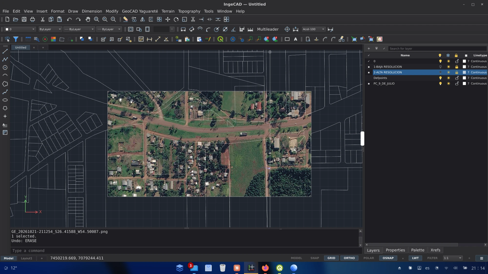
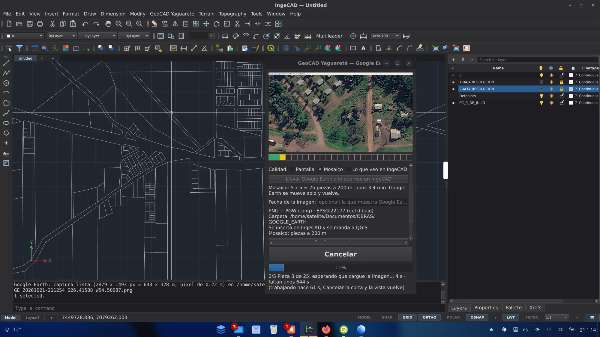
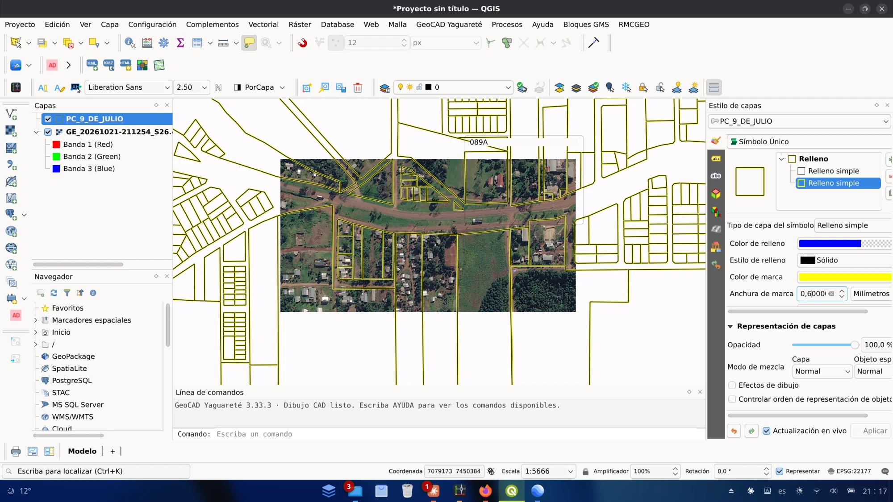
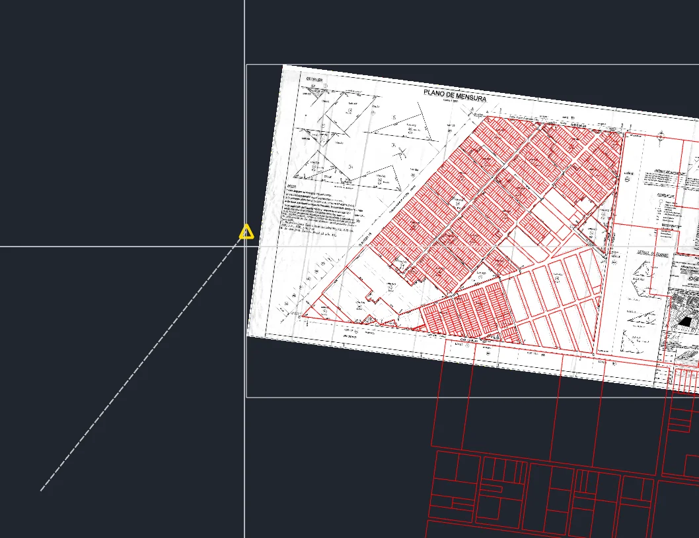
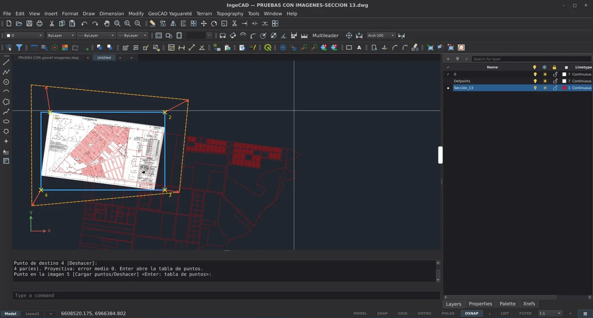

# GEO-CAD-YAGUARETÉ

**GIS to CAD y CAD to GIS: QGIS e IngeCAD trabajando como un mismo sistema.**

Ida y vuelta sobre GeoPackage (.gpkg) y shapefile (.shp) conservando
atributos, con respaldo .zip, control de conflictos y validación antes de
escribir; y herramientas de dibujo, capas, bloques y espacio papel al estilo
AutoCAD, en los dos programas.

> Antes se llamaba **GeoCAD**. Desde la 3.8.0, en el programa: menú y
> barra «GeoCAD Yaguareté» y **Acerca de GEO-CAD-YAGUARETÉ...**

## Imágenes de Google Earth, ya ubicadas

Con **Google Earth Pro**, **IngeCAD** y **QGIS** instalados en la misma
computadora, GeoCAD captura lo que se ve en Google Earth (de una vez o en un
mosaico de hasta 25 fotos más cercanas) y la imagen entra **en su lugar y en
su escala** en el dibujo de IngeCAD y en el proyecto de QGIS, en el sistema
de coordenadas del trabajo, sin georreferenciar a mano. Mientras trabaja se
ve Google Earth en video y el avance pieza por pieza.
**[Cómo se usa](GOOGLE_EARTH.md)** (y por qué hacen falta los tres programas).



| Mientras captura: Google Earth en video y la barra de fotogramas | La misma imagen en QGIS, como capa |
|---|---|
|  |  |

## Imágenes que se toman del marco

El marco de cada imagen del dibujo se engancha con las referencias de
IngeCAD (esquinas, medio, inserción, intersección), como en AutoCAD: una vez
insertada, la imagen se ubica tomándola de una esquina y se escala desde sus
extremos, también girada o recortada.
**[Cómo se usa](IMAGENES.md)**.



## Georreferenciar planos escaneados (GEORREF)

Un plano escaneado o una foto se lleva a su lugar en el dibujo de IngeCAD
marcando pares de puntos (dónde está en la imagen, dónde tiene que quedar),
como el Georreferenciador de QGIS: los mismos siete métodos (Lineal,
Helmert, Polinómica 1, 2 y 3, Thin Plate Spline y Proyectiva), tabla de
puntos con residuos y error medio, el mismo archivo `.points`, y una copia
con su archivo de mundo que QGIS abre en su lugar.
**[Cómo se usa](GEORREF.md)**.



## Módulos (nada invasivo)

Cada parte es un módulo que se elige al instalar y se cambia cuando se quiera
en **GeoCAD Yaguareté > Módulos...** Lo que no se elige no aparece en ningún menú ni
cambia nada del programa.

- **IngeCAD:** Puente con QGIS · Datos · Botón derecho = Enter · Empalme y
  Chaflán estilo AutoCAD · Bloques · Partir en punto · Selección estilo
  AutoCAD · Ángulos relativos al tramo anterior · Google Earth
- **QGIS:** Puente con IngeCAD · Dibujo CAD · Bloques CAD · Espacio papel ·
  Capas CAD (Layer Properties) · Google Earth

## Antes de instalar

GEO-CAD-YAGUARETÉ se instala **dentro** de IngeCAD y de QGIS: primero tienen
que estar los dos programas.

1. **Linux.** Por ahora funciona sólo en Linux.
2. **Instalar IngeCAD y QGIS.** Versiones probadas:
   - IngeCAD 0.6.7 (Flatpak), desde [ingecad.org](https://ingecad.org) o sus
     [versiones](https://github.com/ingelibre/ingecad/releases/latest); también 0.6.5 y 0.6.6.
     Con IngeCAD 0.6.7 hace falta GeoCAD 3.20.1 o más nuevo.
   - QGIS 4.2.2 (Flatpak de [Flathub](https://flathub.org/apps/org.qgis.qgis)),
     3.40.5 (Debian) o 3.28.9 LTS.
3. **Abrir cada programa una vez y cerrarlo.** Al abrirse por primera vez
   crean su carpeta de configuración, y el instalador sólo instala donde
   la encuentra: si un programa nunca se abrió, queda sin GEO-CAD-YAGUARETÉ.
4. **Python 3** (viene con casi todas las distribuciones de Linux).
5. **Capas en un disco externo** (con IngeCAD en Flatpak): darle permiso una
   vez, en una terminal:

   ```bash
   flatpak override --user --filesystem=/media org.ingecad.IngeCAD
   ```

## Instalación

**¿Primera vez?** Seguir la [guía de instalación paso a paso](INSTALAR.md):
desde IngeCAD, desde QGIS o desde una terminal.

En resumen:

1. Descargar la última versión desde
   [Releases](../../releases/latest).
2. Con IngeCAD y QGIS cerrados, en una terminal:

   ```bash
   python3 instalar_geocad_<versión>.py
   ```

   (o doble clic en `INSTALAR_GeoCAD.sh`, que hace lo mismo).

Para QGIS solo: *Complementos > Instalar a partir de ZIP* con
`geocad_qgis_<versión>.zip`.

Después, para actualizar: **GeoCAD Yaguareté > Actualizar GeoCAD Yaguareté...** en cualquiera de
los dos programas.

## Estructura del código

```
COMUN/      núcleo compartido, pruebas automáticas, build.py y CAMBIOS_<versión>.txt
QGIS/       el complemento de QGIS (codigo/geocad)
INGECAD/    el plugin de IngeCAD (codigo/geocad)
```

Cada versión se arma con `python3 COMUN/build.py` y trae su
`COMUN/CAMBIOS_<versión>.txt`.

## Autor

**Arq. Fernando Pablo Bellocchio** · Posadas, Misiones, Argentina.

Desarrollado con la ayuda de [Claude](https://claude.com/claude-code) (Anthropic).

## Contacto

Ideas, problemas y propuestas: en [Issues](../../issues).
¿Trabajás en algo parecido o afín (QGIS, CAD, catastro, agrimensura,
urbanismo)? Escribí: la idea es conectar con otros usuarios y proyectos.

## Licencia

© 2026 Fernando Pablo Bellocchio.
[GPL-3.0-or-later](LICENSE): libre para usar, estudiar, modificar y compartir.
