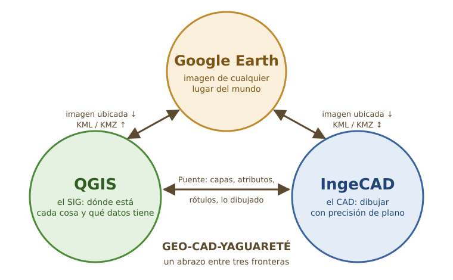

# Introducción — Por qué tender un puente entre el CAD, el SIG y Google Earth

En la selva misionera, donde se juntan la Argentina, el Brasil y el Paraguay,
el yaguareté camina sin saber de fronteras: el monte es uno solo. Con los
datos de un territorio pasa lo mismo. La parcela, el camino o el arroyo son
uno solo, pero para trabajarlos usamos tres programas distintos que no se
hablan entre sí. **GEO-CAD-YAGUARETÉ** nació para borrar esas fronteras: un
abrazo entre tres programas, para que el dato cruce de uno a otro sin
perderse en el camino.

## 1. Tres mundos que se necesitan

### El CAD: dibujar con precisión — IngeCAD

Un programa de CAD (dibujo asistido por computadora) es la mesa de dibujo del
agrimensor, del arquitecto y del ingeniero. Dibuja con exactitud de milímetro:
líneas por rumbo y distancia, empalmes, ochavas, cotas, rótulos, bloques y la
lámina lista para imprimir a escala. **IngeCAD** es un CAD libre, liviano y
con las órdenes de siempre.

Lo que el CAD **no** sabe por sí solo es *dónde* está en el mundo ese dibujo
ni *qué datos* tiene cada línea: para él, un lote es un polígono más, sin
partida, sin titular, sin superficie registrada.

### El SIG: saber dónde está cada cosa — QGIS

Un Sistema de Información Geográfica (SIG) guarda cada objeto en su lugar
real, en un sistema de coordenadas (por ejemplo, POSGAR 2007 en su faja), y
con su tabla de datos: partida, lote, titular, uso del suelo. Permite
consultar («¿qué parcelas superan los 1 000 m²?»), hacer mapas temáticos y
cruzar capas. **QGIS** es el SIG libre más usado del mundo.

Lo que al SIG le cuesta es justamente lo que el CAD hace bien: dibujar y
editar con precisión de plano, con referencias a objetos, recortes,
empalmes y una lámina prolija.

### Google Earth: el insumo geográfico de cualquier lugar

**Google Earth Pro** pone en la pantalla una imagen satelital de casi
cualquier punto del planeta, con relieve y con **imágenes históricas** para
ver cómo era un lugar hace diez o veinte años. Para un relevamiento, un
anteproyecto o un informe, es muchas veces el primer insumo — y a veces el
único disponible.

Pero Google Earth no entrega sus imágenes ubicadas en el sistema de
coordenadas del trabajo: lo que se ve en pantalla es una foto sin
referencia, que hay que georreferenciar a mano.

## 2. Lo que cuesta trabajar con islas

Sin un puente, cada programa es una isla y el trabajo se pierde en los
cruces:

- **Exportar e importar a mano**, una y otra vez, perdiendo en el camino
  atributos, capas, colores y rótulos.
- **Georreferenciar a ojo** la imagen de Google Earth o el plano escaneado,
  con errores de metros que después nadie ve.
- **Dos versiones del mismo dato** — la del dibujo y la de la capa — que con
  el tiempo dejan de coincidir. ¿Cuál es la buena?
- **Aprender dos idiomas**: órdenes, unidades y ángulos distintos en cada
  programa.

## 3. Lo que cambia con el puente

Con GEO-CAD-YAGUARETÉ instalado dentro de IngeCAD y de QGIS:

- **Un mismo dato, dos formas de trabajarlo.** Se edita en el programa que
  mejor lo hace y vuelve al otro conservando sus atributos.
- **Los datos nunca corren riesgo.** Antes de escribir una capa, GeoCAD hace
  un respaldo (.zip), valida la geometría y controla que nadie la haya
  cambiado mientras tanto.
- **La imagen de Google Earth entra ya en su lugar** y en su escala, en el
  sistema de coordenadas del trabajo, en IngeCAD y en QGIS a la vez.
- **El resultado vuelve al mundo**: el trabajo se exporta a KML/KMZ para
  mostrarlo en Google Earth a un cliente, a un vecino o a un juzgado.
- **Nada es invasivo.** Cada parte se elige al instalar y se apaga cuando se
  quiera; apagada, el programa queda como venía.
- **En Windows y en Linux.** Lo mismo en los dos sistemas; lo poco que
  cambia se marca con 🪟 y se resume en el capítulo final.

## 4. Todas las vinculaciones que hacen real el puente

Estas son las conexiones que desarrollamos para que el puente funcione en la
práctica, no sólo en el papel. Cada una se explica paso a paso en su
capítulo.

| Vinculación | Desde → hacia | Qué viaja | Cómo se usa | Capítulo |
|---|---|---|---|---|
| **Enviar a IngeCAD** | QGIS → IngeCAD | capas con su geometría, rótulos y simbología de QGIS convertidos en textos y colores del dibujo | menú GeoCAD Yaguareté en QGIS | 1 |
| **Devolver a QGIS** | IngeCAD → QGIS | lo dibujado o corregido, todo o sólo lo seleccionado | órdenes DEVOLVERQGIS y DEVOLVERSEL | 2 |
| **Dibujo conectado a capas** | IngeCAD ⇄ SHP / GeoPackage | geometría y tabla de atributos, con respaldo, validación y control de conflictos | CONECTARSHP, GUARDARSHP, IMPORTARSHP, EXPORTARSHP | 2 |
| **Buzón común** | IngeCAD ⇄ QGIS | el aviso de que el otro programa mandó algo, y la configuración compartida | automático | 1 y 2 |
| **Mismo sistema de coordenadas** | los tres | el sistema del trabajo (por ejemplo POSGAR 2007, faja 7) y la reproyección cuando hace falta | SISTEMAGEO en IngeCAD; el proyecto en QGIS | 1 y 2 |
| **Captura de Google Earth** | Google Earth → IngeCAD y QGIS | la imagen de la pantalla o un mosaico de hasta 25 fotos, ubicada y en escala | Abrir Google Earth con GeoCAD (ABRIRGE); en Windows desde la 3.75.0 | 3 |
| **Llevar Google Earth a lo que veo** | IngeCAD / QGIS → Google Earth | la vista actual del dibujo o del mapa | botón de la ventanita de GeoCAD | 3 |
| **Exportar a Google Earth** | IngeCAD / QGIS → Google Earth | dibujos y capas como KML/KMZ, con nombres, colores y rótulos | EXPORTARKML; Exportar a Google Earth y Ver en Google Earth en QGIS | 1, 2 y 3 |
| **Traer de Google Earth** | Google Earth → IngeCAD | lugares y trazados marcados en Google Earth | IMPORTARKML | 2 y 3 |
| **Pegar en su lugar** | entre dibujos y programas | entidades con sus coordenadas reales | PEGARENLUGAR | 1 y 2 |
| **Actualizar** | IngeCAD y QGIS | la versión nueva de GeoCAD, que se encuentra sola | GeoCAD Yaguareté > Actualizar | Final |

## 5. Un mismo idioma en los dos programas

Para que pasar de un programa al otro no sea cambiar de oficio, GeoCAD trae
**las mismas partes y los mismos nombres** en IngeCAD y en QGIS:

- **Los mismos módulos:** Puente, Datos, Dibujo, Capas, Bloques, Papel y
  Google Earth, que se prenden y se apagan en **GeoCAD Yaguareté >
  Módulos…**
- **Las mismas órdenes** escritas, al estilo de AutoCAD: LINEA, POLILINEA,
  RECORTA, ALARGA, EMPALME, EQDIST, OCHAVA…
- **Los mismos ángulos y unidades**, incluso los ángulos relativos al tramo
  anterior, como se mide en el terreno.
- **Los mismos hábitos:** botón derecho = Enter, selección por ventana y por
  captura, referencias a objetos.

## 6. Cómo leer este manual

El manual sigue **un caso práctico de punta a punta**, con **datos reales**:
14 manzanas de **Corpus, Misiones** (107 parcelas), con la geometría tal
como está en el catastro y los números de manzana, lote y partida
cambiados por otros inventados. La manzana del centro es la **manzana 12**.
Las parcelas vienen en **POSGAR 2007, faja 6**, en el archivo
`datos_ejemplo/parcelas.shp` de esta carpeta, para que cada práctica se
pueda hacer con los mismos datos.

La manzana nace como capa en QGIS, se dibuja y se rotula en IngeCAD,
recibe la imagen de Google Earth, vuelve a QGIS y termina en Google Earth
como KMZ para el cliente. Así se ve el puente funcionando, no sólo piezas
sueltas. Las capturas de pantalla son de **QGIS 4.2.2 e IngeCAD 0.7.0
reales, con GeoCAD 3.74.1**, trabajando sobre esos datos.

Cada función se explica con la misma ficha:

1. **Para qué sirve** — el problema que resuelve.
2. **Dónde está** — menú, barra, botón u orden escrita.
3. **Paso a paso** — numerado, con capturas.
4. **Qué tiene que pasar** — cómo saber que salió bien.
5. **Si algo no anda** — los errores conocidos y su arreglo.

| Capítulo | Contenido |
|---|---|
| 1 | GeoCAD en QGIS |
| 2 | GeoCAD en IngeCAD |
| 3 | GeoCAD en Google Earth |
| Final | Dónde conseguir e instalar QGIS, IngeCAD, Google Earth Pro y GeoCAD |
