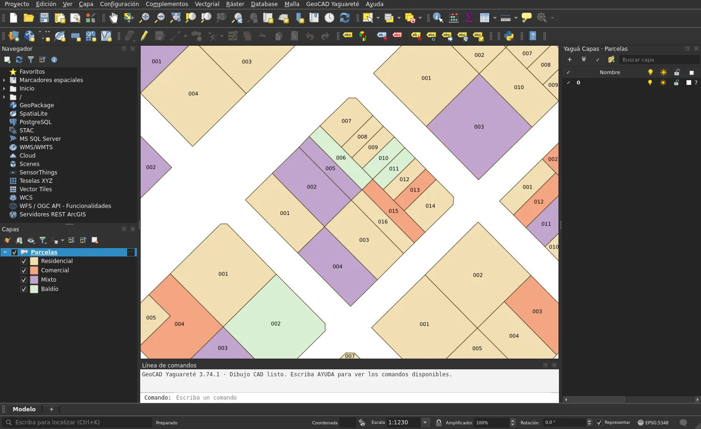
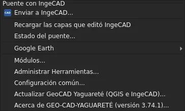
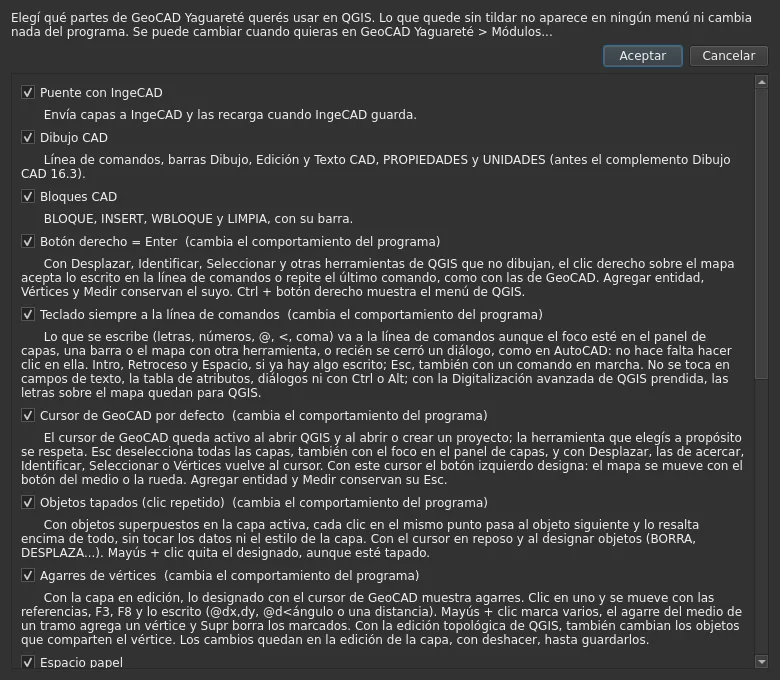
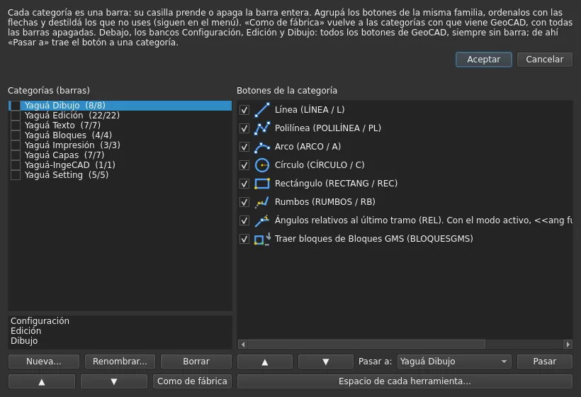
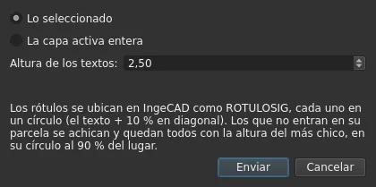
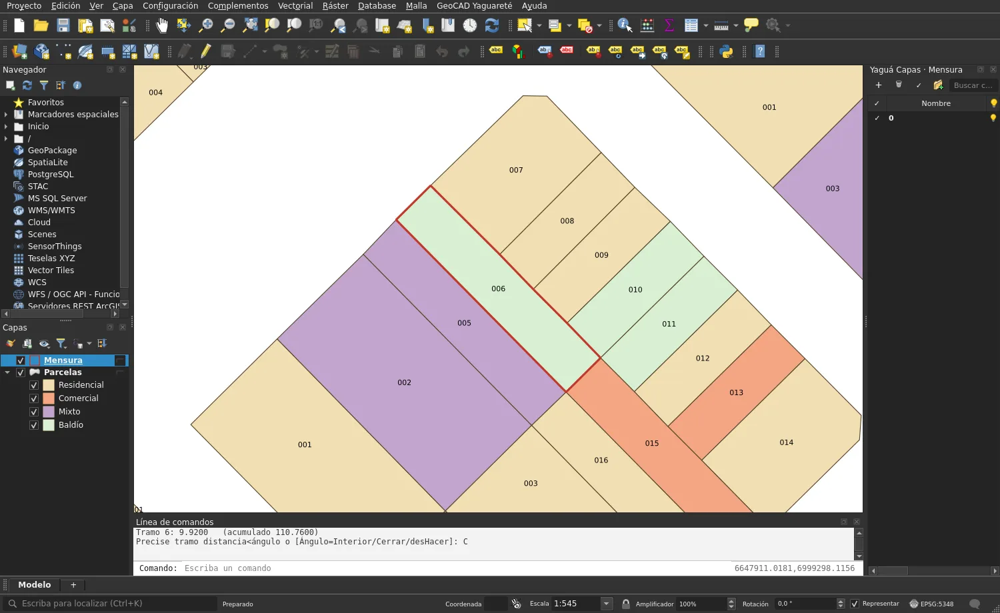
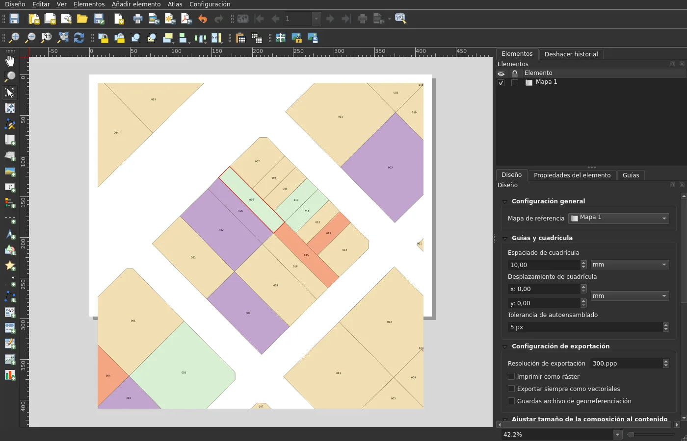
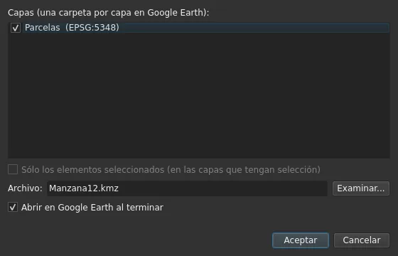

# Capítulo 1 — GeoCAD en QGIS

QGIS es el lugar donde viven los datos: cada objeto en su sitio real y con su
tabla. Con GeoCAD, QGIS además **dibuja como un CAD** — con línea de
comandos, referencias a objetos y órdenes al estilo de AutoCAD — y **se habla
con IngeCAD y con Google Earth**.

## 1.1 Primeros pasos

### El menú GeoCAD Yaguareté

| Parte del menú | Qué tiene |
|---|---|
| **Puente con IngeCAD** | Enviar a IngeCAD…, Recargar las capas que editó IngeCAD, Estado del puente… |
| Pegar en el lugar (PEGARORIG, Ctrl+Alt+V) | pegar con las coordenadas de origen |
| **Google Earth** | Abrir Google Earth con GeoCAD, Capturar vista (Ctrl+Alt+G), Configurar captura… y Manual de Google Earth (capítulo 3) |
| Módulos…, Administrar Herramientas…, Configuración común…, Actualizar | mantenimiento |
| **Manual de usuario (QGIS)…** | abre este capítulo en GitHub (desde la 3.76.0) |
| Acerca de… | la versión instalada |

Además aparecen, según los módulos prendidos, la **línea de comandos**, las
barras **Dibujo, Edición, Texto y Bloques CAD**, el menú y la barra **Capas
CAD**, y las pestañas **Modelo / Presentaciones**.

### Módulos

**GeoCAD Yaguareté > Módulos…** Lo apagado no aparece y deja QGIS como
venía.

| Módulo | Para qué |
|---|---|
| Puente con IngeCAD | enviar capas a IngeCAD y recargarlas cuando IngeCAD guarda |
| Dibujo CAD | línea de comandos, barras Dibujo, Edición y Texto CAD, PROPIEDADES, UNIDADES |
| Bloques CAD | BLOQUE, INSERT, WBLOQUE y LIMPIA |
| Botón derecho = Enter | también con Desplazar, Identificar y Seleccionar; Ctrl + botón derecho: el menú de QGIS |
| Teclado siempre a la línea de comandos | escribir sin hacer clic en ella |
| Cursor de GeoCAD por defecto | el botón izquierdo designa; el mapa se mueve con la rueda; Esc deselecciona |
| Objetos tapados (clic repetido) | cada clic en el mismo punto pasa al objeto de abajo |
| Agarres de vértices | mover, agregar y borrar vértices como en AutoCAD |
| Referencias con Shift + clic derecho | el menú de referencias de IngeCAD, también en las herramientas de QGIS |
| Espacio papel | presentaciones, VENTANAS, BLOQVENT, TRAZAR (apagado de fábrica) |
| Capas CAD (Layer Properties) | capas estilo AutoCAD dentro de una capa (apagado de fábrica) |
| Pegar en el lugar | PEGARORIG |
| Crear capa a partir de elementos seleccionados | una capa filtrada por la selección |
| Tablas | pegar una planilla en las composiciones |
| Imagen base | correr y bloquear la imagen de fondo en una composición |
| Google Earth | captura georreferenciada y mosaico |

> 💡 La **primera vez** que se instala, QGIS muestra sólo la línea de
> comandos: los módulos con panel o barra se prenden a pedido.

### Administrar Herramientas

**GeoCAD Yaguareté > Administrar Herramientas…** arma las barras a gusto:

- **Bancos y categorías** propias, con los botones de la misma familia.
- **El lugar de cada herramienta**: **Espacio Modelo** (la ventana principal)
  o **Espacio Presentaciones** (la ventana de las composiciones). Se elige
  de a una o «toda la categoría».
- Algunas herramientas viven **sólo aquí**, no en el menú: por ejemplo
  Exportar a Google Earth y Ver en Google Earth; Imagen base y Copiar
  tabla quedan de respaldo en el banco Edición.

En las presentaciones, **Ver > Herramientas GeoCAD** muestra u oculta las
barras de GeoCAD de esa ventana.

## 1.2 El Puente con IngeCAD

### Enviar a IngeCAD

**Para qué sirve:** llevar las parcelas (o cualquier capa) a IngeCAD para
dibujar, rotular y armar la lámina, sin perder el vínculo con la tabla.

**Dónde está:** **GeoCAD Yaguareté > Enviar a IngeCAD…**

**Paso a paso:**

1. Elegir la capa activa y, si se quiere sólo una parte, seleccionar los
   objetos.
2. **Enviar a IngeCAD…**
3. Elegir **Lo seleccionado** o **La capa activa entera**, y la **altura de
   los textos** (2,5 de entrada). La ventana recuerda lo elegido.
4. **Aceptar.** Si IngeCAD no está abierto, GeoCAD lo abre.

**Qué tiene que pasar:**

- En IngeCAD llegan las capas con **sus colores y su temático** tal como se
  ven en QGIS.
- Los **rótulos** de QGIS llegan como textos ubicados al estilo ROTULOSIG,
  cada uno en un círculo; los que no entran en su parcela se achican y
  quedan todos con la altura del más chico.
- Cada objeto queda **vinculado** a su registro: lo que se cambie en IngeCAD
  vuelve con DEVOLVERQGIS.

### Cuando IngeCAD devuelve

- Al guardar en IngeCAD (DEVOLVERQGIS, DEVOLVERSEL), QGIS recibe el aviso
  por el buzón común y **recarga las capas solo**. **Recargar las capas que
  editó IngeCAD** lo hace a mano, si hiciera falta. 🔁
- Lo que IngeCAD manda con **ENVIARQGIS** llega como **capas nuevas**.
- **Estado del puente…** muestra la versión, los módulos, la carpeta común
  y si IngeCAD está abierto. Si IngeCAD tiene otra versión de GeoCAD, lo
  avisa: hay que actualizar los dos.

### Práctica 1.A — La manzana viaja a IngeCAD

1. Abrir en QGIS la capa de ejemplo `datos_ejemplo/parcelas.shp` (POSGAR
   2007, faja 6). Ponerle un estilo **categorizado por USO** y rótulos con el
   campo **LOTE**, como en la primera imagen de este capítulo.
2. **Enviar a IngeCAD…** → *La capa activa entera*, altura 2,5.
3. En IngeCAD, las 107 parcelas aparecen con los mismos colores y los lotes
   en círculos.
4. Corregir en IngeCAD un lindero y **DEVOLVERQGIS**. En QGIS la capa se
   recarga: la parcela cambió y la tabla está igual.

## 1.3 Dibujar como en un CAD

### La línea de comandos

Abajo de la ventana de QGIS: se escribe la orden (LINEA, L, POLILINEA, PL…)
y se contesta lo que pide, como en AutoCAD. Las opciones van entre
corchetes; Enter (o el botón derecho) acepta o repite la última orden.
**UNIDADES** fija unidades lineales y angulares; **ORTO** (F8) bloquea a
horizontal y vertical; las referencias se prenden con **F3**.

### Dibujar

| Orden | Para qué |
|---|---|
| **LINEA** (L), **POLILINEA** (PL) | tramos por clic o escritos: `@dx,dy`, `@distancia<ángulo` |
| Rectángulo, círculo, arco | en la barra Dibujo CAD |
| **RUMBOS** (RB) | poligonal por rumbo y distancia (ver abajo) |
| Texto CAD | textos con altura, estilo y alineación; listas desplegables en la barra Texto CAD |

**Ángulos relativos (REL, ANGREL):** con el modo relativo, `@d<ángulo` es el
ángulo **interior** desde el tramo anterior, antihorario (180 = sigue
derecho): como se mide en el terreno.

### RUMBOS: una mensura en QGIS

**Para qué sirve:** cargar una poligonal de mensura tramo por tramo, con
ángulos en grados, minutos y segundos.

**Paso a paso:**

1. **RUMBOS** (RB).
2. Dos clics para el **tramo base** (con referencias): da la dirección del
   primer ángulo.
3. Elegir el **Modo**: Polilínea (un solo objeto; en una capa de polígonos se
   cierra) o Tramos (un objeto por tramo).
4. Cada tramo: `25.4<91d30'15"` (distancia y ángulo **interior**, 180 =
   derecho). También valen la **deflexión** (`30dI`, `30dD`), los rumbos
   (`N45d30'E`) y el ángulo absoluto (`<<`).
5. **Cerrar** o Enter para terminar. **desHacer** borra el último tramo.

La línea de comandos muestra la longitud de cada tramo y la acumulada. No
toca la tabla de la capa.

### Editar

| Orden | Para qué |
|---|---|
| **DESPLAZA** (MOVER), **COPIA**, **GIRAR** (ROTAR), **ESCALA**, **SIMETRIA** (ESPEJO) | mover, copiar, girar, escalar, reflejar, con punto base y referencias |
| **MATRIZ** | copias en filas y columnas o alrededor de un centro |
| **ESTIRA** | estirar lo atrapado por una ventana |
| **EQDIST** (DESFASE, OFFSET) | paralela a una distancia o por un punto |
| **RECORTA**, **ALARGA** | cortar o prolongar hasta un borde |
| **EMPALME**, **CHAFLAN** | redondear o biselar esquinas |
| **OCHAVA** | la ochava de una esquina |
| **PARTE**, **PARTEENPUNTO** | partir en dos puntos o en uno |
| **DIVIDE**, **GRADUA** (MEDIR) | marcar partes iguales o cada tanta distancia |
| **ALINEAR**, ALINEARCOPIA | llevar con dos pares de puntos (mover, girar, escalar) |
| **PERPENDICULAR** | una línea perpendicular desde un punto |
| **IGUALARPROP** | copiar capa CAD, color y estilo de un objeto a otros |
| **COPIABASE**, **PEGARBASE** | copiar y pegar con punto base |
| **DESCOMP** (DESCOMPONER) | separar en partes |
| **BORRA** | borrar |

### Designar, referencias y agarres

- **Cursor de GeoCAD:** el botón izquierdo designa (clic, ventana, captura);
  el mapa se mueve con la rueda o el botón del medio. **Esc** deselecciona.
- **Objetos tapados:** cada clic en el mismo punto pasa al objeto de abajo;
  Mayús + clic quita uno de la selección.
- **Referencias (Shift + clic derecho):** Punto final, Punto medio,
  Intersección, Intersección aparente, Extensión, Centro, Cuadrante,
  Tangente, **Perpendicular**, Paralela, Nodo, Inserción, Cercano, Desde…
  — también con las herramientas de digitalizar de QGIS. Perpendicular e
  Intersección aparente prolongan las líneas con trazo de puntos.
- **Agarres** (capa en edición): clic en un vértice y se mueve con
  referencias, F3, F8 o escribiendo `@dx,dy`; Mayús + clic marca varios; el
  agarre del medio de un tramo agrega un vértice; **Supr** borra los
  marcados. Con la edición topológica de QGIS, también se mueven los
  vecinos que comparten el vértice.

> ⚠ Los cambios quedan en la **edición de la capa**, con deshacer, hasta
> que se guardan. Nada se escribe en el archivo sin guardar.

### Práctica 1.B — Digitalizar una parcela desde la mensura

Es el **lote 006 de la manzana 12**: un lote real, largo y angosto, de 7
vértices. Sus lados, con el ángulo interior de cada vértice recorriendo en
sentido **horario** (el de RUMBOS), son:

| Tramo | Distancia (m) | Ángulo interior | Escribir |
|---|---|---|---|
| 1 | 10,10 | 90°49'06" | `10.10<90d49'06"` |
| 2 | 50,31 | 89°49'18" | `50.31<89d49'18"` |
| 3 | 10,10 | 90°10'42" | `10.10<90d10'42"` |
| 4 | 20,28 | 90°17'54" | `20.28<90d17'54"` |
| 5 | 10,05 | 178°52'31" | `10.05<178d52'31"` |
| 6 | 9,92 | 180°58'28" | `9.92<180d58'28"` |
| 7 | 10,05 | 179°02'01" | **Cerrar** |

Los tramos 5, 6 y 7 casi siguen derecho (ángulos cerca de 180°): el lado
del fondo tiene dos quiebres chicos, como pasa en las mensuras reales.

1. Agregar a QGIS una capa de polígonos nueva («Mensura», POSGAR 2007 faja
   6) y ponerla en edición.
2. **RUMBOS**. Tramo base: el último lado del lote (dos clics con *Punto
   final*: primero el vértice del fondo, después la esquina donde empieza
   el tramo 1). Modo Polilínea.
3. Escribir los tramos 1 a 6 de la tabla y **Cerrar**.
4. Guardar la edición.

**Qué tiene que pasar:** el polígono rojo cae **sobre el lote 006** de la
capa de parcelas. En nuestra prueba la diferencia fue de 0,18 m², lo que da
el redondeo a centímetros y segundos.

## 1.4 Capas CAD (Layer Properties)

**Para qué sirve:** ordenar una sola capa de QGIS en **capas al estilo
AutoCAD** (muros, ejes, cotas, textos…), cada una con su color, tipo y
grosor de línea, sin multiplicar archivos.

**Cómo funciona:** cada objeto lleva su capa CAD en el campo **LAYER_CODE**
(y su color, tipo y grosor propios en CAD_COLOR, CAD_LTYPE y CAD_LW).

**Dónde está:** menú **Capas CAD**, la barra **Capas CAD** (lista de capa,
Color, Tipo y Grosor de línea, como la de IngeCAD) y el **panel Capas**.

| Orden | Para qué |
|---|---|
| **CAPA** (LAYER) | el administrador de capas |
| **LAYISO** / LAYUNISO (AISLARCAPA) | dejar visible sólo la capa de un objeto, y volver |
| **LAYOFF** / LAYON (DESACTCAPA / ACTCAPA) | apagar o prender |
| **LAYFRZ** / LAYTHW (INUTCAPA / REUTCAPA) | inutilizar o reutilizar |
| **LAYLCK** / LAYULK (BLOQCAPA / DESBLOQCAPA) | bloquear o desbloquear |
| **LAYMCH** (IGUALARCAPA) | pasar objetos a la capa de otro |
| **LAYMCUR** (ESTCAPACT) | hacer actual la capa de un objeto |
| **LAYERP** (CAPAP) | volver al estado de capas anterior |
| **LWDISPLAY** (GROSORVIS) | ver u ocultar los grosores |

Los colores son los **ACI** de AutoCAD (1 rojo, 2 amarillo…), y el orden de
dibujo se maneja como en AutoCAD.

## 1.5 Bloques CAD

**BLOQUE** crea un bloque con nombre y punto base; **INSERT** (INSERTAR) lo
ubica con escala y giro; **WBLOQUE** lo guarda en un archivo para otros
proyectos; **LIMPIA** borra los que no se usan; **DESCOMP** lo separa en sus
partes.

## 1.6 La lámina: espacio papel

**Para qué sirve:** armar la lámina como en AutoCAD, con la hoja en escala
real y ventanas a escala.

| Orden | Para qué |
|---|---|
| **PRESENTACION** | crear, renombrar, copiar, borrar presentaciones (pestañas Modelo / Presentaciones) |
| **VENTANAS** | ventanas en la hoja; escala escrita como AutoCAD (1/100XP) |
| **BLOQVENT** | bloquear la escala y el encuadre de una ventana |
| **TRAZAR** | imprimir o exportar a PDF, con estilos de trazado @cad_ctb |

### Herramientas de las presentaciones

En la ventana de cada composición (barra de GeoCAD):

- **Imagen base**: tres botones. **Desplazar imagen** corre la imagen de
  fondo (teselas XYZ como Google, una captura o cualquier ráster) por debajo
  de las capas; **Bloquear imagen** la deja fija; **Guardar recorte** guarda
  lo que se ve (y un 25 % alrededor) como GeoTIFF con la georreferencia
  lograda. Esc la devuelve a su lugar.
- **Pegar tabla**: pega lo copiado en una planilla (GenOffice, Calc, Excel)
  o en la tabla de atributos de QGIS como **tabla de QGIS con su formato**,
  ubicada con dos puntos.
- **Copiar tabla**: copia una tabla de la composición con su formato.

### Práctica 1.C — La lámina A3 de la manzana

1. **PRESENTACION** → Nueva, «Manzana 12 A3».
2. **VENTANAS** → una ventana a **1/1000XP** sobre la manzana; **BLOQVENT**.
3. En la composición, **Pegar tabla** con el cuadro de superficies copiado
   de la planilla.
4. **TRAZAR** → PDF.

## 1.7 Crear capa a partir de elementos seleccionados

**Para qué sirve:** separar en una capa aparte lo elegido (por ejemplo, las
parcelas de un expediente) sin copiar archivos.

**Dónde está:** menú **Vectorial** y clic derecho sobre la capa (antes de
Duplicar capa). No va en el menú GeoCAD.

**Paso a paso:** seleccionar los objetos → **Crear capa a partir de
elementos seleccionados**. De cada capa con selección sale una capa nueva
**con su estilo** que muestra sólo esos objetos.

> 💡 Es un **filtro**: no crea archivos ni escribe en la fuente. Reemplaza
> al complemento externo «Create layer from selected features», que GeoCAD
> retira al instalarse.

## 1.8 Pegar en el lugar

**PEGARORIG** (Ctrl+Alt+V), en el menú **Edición** debajo de Pegar objetos
espaciales: pega en la capa activa lo copiado (Ctrl+C) en QGIS **o en
IngeCAD**, en sus mismas coordenadas, con su capa CAD, color, tipo y grosor.
Lo copiado en QGIS con Ctrl+C queda listo para pegarlo en el lugar en
IngeCAD. 🔁

## 1.9 Google Earth desde QGIS

- **Capturar imagen ubicada**: GeoCAD Yaguareté > Google Earth (capítulo
  3, 3.4). La imagen entra como capa en QGIS y llega también a IngeCAD.
- **Exportar a Google Earth (KML/KMZ)…** y **Ver en Google Earth**: en
  Administrar Herramientas, con el control de sistema y faja (capítulo 3,
  3.5).

## 1.10 Mantener GeoCAD al día

- **GeoCAD Yaguareté > Actualizar GeoCAD Yaguareté (QGIS e IngeCAD)…**:
  busca la versión nueva y la instala en los dos programas.
- **Acerca de…**: la versión instalada.
- **Configuración común…**: las opciones que comparten QGIS e IngeCAD.
