# Capítulo 2 — GeoCAD en IngeCAD

IngeCAD es la mesa de dibujo del puente. Con GeoCAD, además de dibujar con
precisión, **sabe dónde está en el mundo**, **conoce los datos** de cada
objeto y **se habla con QGIS y con Google Earth**. Y se comporta como
AutoCAD en lo que el usuario ya tiene en las manos.

## 2.1 Primeros pasos

### El menú y la barra GeoCAD Yaguareté

Todo lo de GeoCAD está en el menú **GeoCAD Yaguareté** y en su barra. Cada
función también es una **orden escrita** en la línea de comandos, en español
(las de inglés siguen andando: ENVIARQGIS o QGISEXPORT).

| Parte del menú | Qué tiene |
|---|---|
| Enviar la selección a QGIS como capas nuevas | el Puente hacia QGIS |
| **Datos** | tabla de atributos, consultas, temático, rótulos, objeto nuevo |
| **Puente** | conectar capas SIG, cambios pendientes, guardar, desconectar |
| **Sistema de coordenadas** | SISTEMAGEO y REPROYECTAR |
| **Importar / Exportar** | SHP y KML/KMZ |
| **Google Earth** | abrir, capturar, configurar y el manual de Google Earth (capítulo 3) |
| Herramientas de dibujo e imágenes | según los módulos prendidos |
| **Bloques, Impresión, Cotas** | bancos de herramientas |
| Módulos…, Administrar Herramientas…, Configuración común…, Actualizar, Diagnóstico | mantenimiento |
| **Manual de usuario (IngeCAD)…** (MANUALGEOCAD) | abre este capítulo en GitHub (desde la 3.76.0) |
| Acerca de… | la versión instalada |

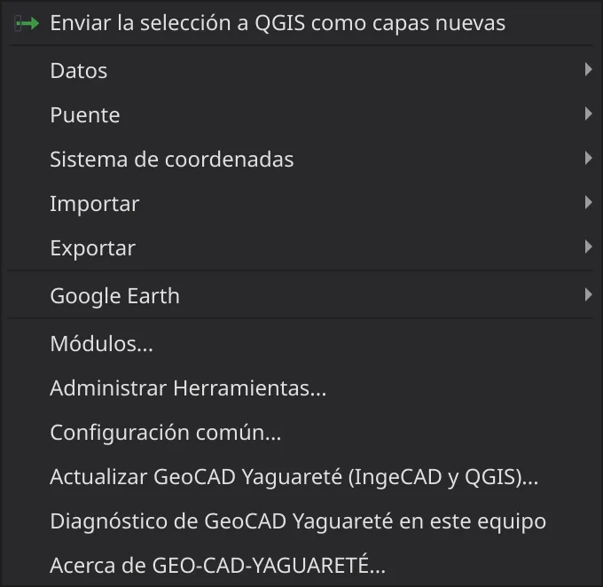

### Módulos: prender sólo lo que se usa

**GeoCAD Yaguareté > Módulos…** (MODULOSGEOCAD). Cada casilla prende o apaga
una parte; lo apagado no aparece en ningún menú y **deja IngeCAD como
venía**. Los módulos marcados como «cambia el programa» (botón derecho,
selección, empalme…) cambian cómo se comporta IngeCAD: se eligen a
conciencia.

| Módulo | Para qué |
|---|---|
| Puente con QGIS | recibir y devolver capas de QGIS |
| Datos | tabla, consultas, temático, rótulos, formulario |
| Intercambio | sistema de coordenadas, importar y exportar SHP y KML |
| Botón derecho = Enter | termina la orden y repite la última (Ctrl + botón derecho: el menú) |
| Selección estilo AutoCAD | W, C, WP, CP, F, ALL, L, P, R, A, U… y FILTRO |
| Empalme, Chaflán, Partir en punto, Estirar, Igualar propiedades | edición como AutoCAD |
| Texto como AutoCAD | TEXTO / DT con altura y dirección por puntos |
| Ángulos relativos | @d<ángulo como ángulo interior desde el tramo anterior |
| Agarres de vértices | escribir el punto, varios agarres, agregar o borrar vértices |
| Perpendicular y Apparent Intersection con guías | referencias con prolongación punteada |
| Teclado siempre a la línea de comandos | escribir sin hacer clic en ella |
| Bloques | BLOQUE mejorado y edición en el lugar |
| Imágenes georreferenciadas | GEORREF, INSERTARGEO, EXPORTARGEO, ASPECTOIMAGEN, pegar capturas |
| Orden de dibujo | ALFRENTE, ALFONDO |
| Espacio papel, Vista previa y plumas, Cotas | la lámina como AutoCAD |
| Tablas | PEGARTABLA |
| Pegar en el lugar | PEGARORIG (Ctrl+Alt+V) |
| Propiedades en masa | la paleta Properties con muchos objetos |
| Uniones de los grosores | esquinas en inglete con LWT |
| Control de los DWG | las falsas alarmas de LibreDWG, fuera |
| Google Earth | captura georreferenciada y mosaico |

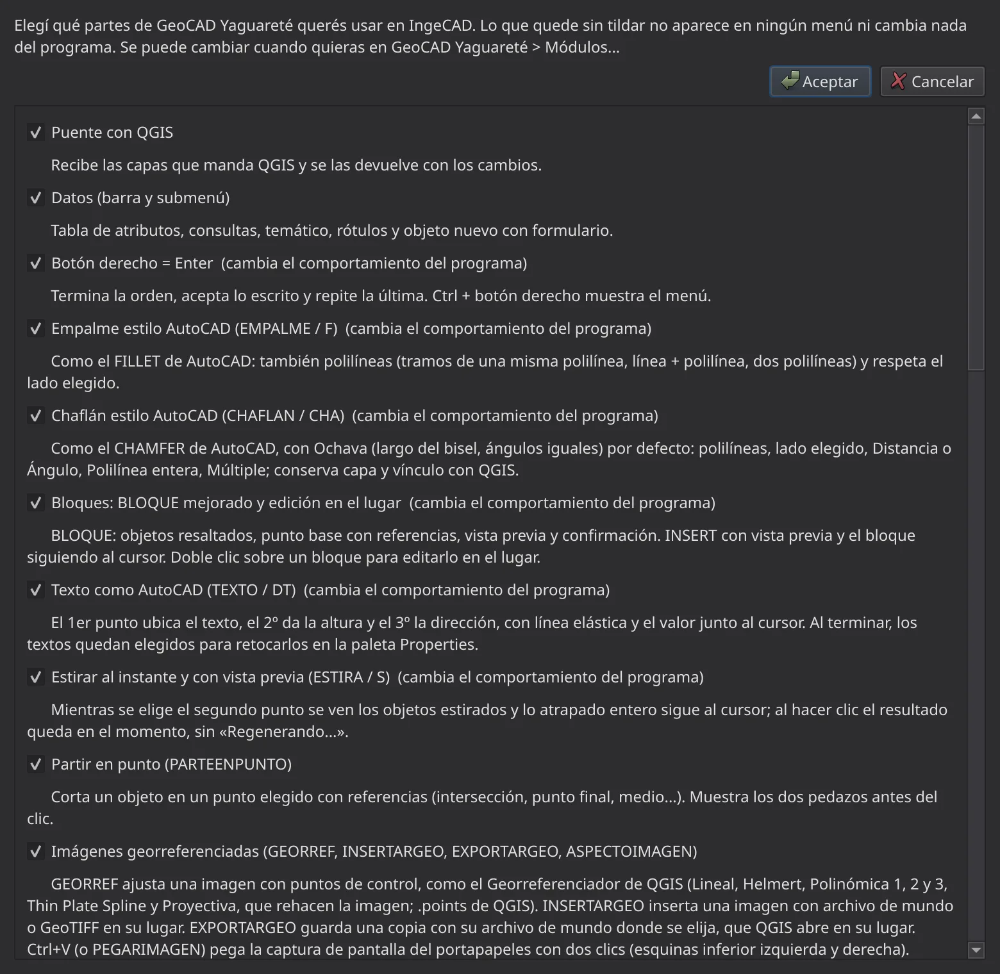

**Administrar Herramientas…** arma la barra a gusto:
categorías propias y qué botón va en cada una.

### Decirle al dibujo dónde está: SISTEMAGEO

**Para qué sirve:** que el dibujo sepa en qué sistema de coordenadas está
(por ejemplo, POSGAR 2007, faja 7). Sin eso no hay puente con QGIS ni con
Google Earth.

**Dónde está:** **GeoCAD Yaguareté > Sistema de coordenadas > Definir o
redefinir sistema de coordenadas…**, u orden **SISTEMAGEO**.

**Paso a paso:**

1. **SISTEMAGEO**.
2. Elegir el marco (POSGAR 2007, POSGAR 94, Campo Inchauspe…) y la faja, o
   buscar otro sistema.
3. **Aceptar.** No se mueve nada del dibujo: sólo se declara dónde está.

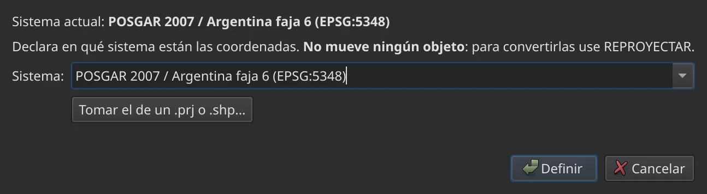

> ⚠ Si las coordenadas del dibujo dicen otra faja que la elegida, GeoCAD
> **avisa**: es el error que manda los trabajos a cientos de kilómetros.

Para **convertir** el dibujo a otro sistema (por ejemplo, de Campo Inchauspe
a POSGAR 2007): **REPROYECTAR**. Esa sí mueve todo, con PROJ; **U** lo
deshace.

## 2.2 El Puente con QGIS

El dato viaja entre los dos programas **conservando sus atributos**, y
GeoCAD cuida que no se pise nada.

### Recibir de QGIS

Desde QGIS se usa **Enviar a IngeCAD** (capítulo 1). En IngeCAD las capas
llegan con su geometría, sus rótulos y su simbología convertidos en textos y
colores del dibujo, y cada objeto **vinculado** a su registro de la tabla.

### Conectar capas SIG directamente

**Para qué sirve:** trabajar en IngeCAD sobre un SHP o un GeoPackage y
guardar los cambios en el mismo archivo, sin pasar por QGIS.

**Dónde está:** **GeoCAD Yaguareté > Puente**.

| Orden | Menú | Qué hace |
|---|---|---|
| **CONECTARSHP** | Conectar datos SIG (GPKG / SHP)… | trae la capa al dibujo, vinculada |
| **ESTADOSHP** | Cambios pendientes | qué se cambió y todavía no se guardó |
| **GUARDARSHP** | Guardar cambios de una capa… | escribe los cambios en el archivo |
| **DESCONECTARSHP** | Desconectar capa SIG | suelta el vínculo |

**Qué hace GeoCAD antes de escribir** — los datos nunca corren riesgo:

1. **Respaldo**: una copia .zip de la capa como estaba.
2. **Validación**: revisa que las geometrías sean correctas.
3. **Control de conflictos**: si el archivo cambió desde que se conectó
   (alguien lo editó en QGIS), avisa en vez de pisarlo.

### Devolver a QGIS

| Orden | Qué hace |
|---|---|
| **DEVOLVERQGIS** | devuelve a QGIS la capa con todos los cambios |
| **DEVOLVERSEL** | devuelve sólo lo seleccionado |
| **ENVIARQGIS** | manda lo seleccionado a QGIS como **capas nuevas** (lo dibujado que todavía no es capa) |

QGIS recibe el aviso por el **buzón común** y carga la capa. 🔁

### Práctica 2.A — Corregir un lindero sin perder la tabla

1. En QGIS, **Enviar a IngeCAD** la capa de parcelas de la manzana.
2. En IngeCAD, mover con **agarres** el vértice mal ubicado de una parcela
   hasta el mojón (referencia *Punto final*).
3. **ESTADOSHP**: aparece una parcela modificada.
4. **DEVOLVERQGIS**. En QGIS la parcela tiene la forma nueva y **la misma
   partida, titular y superficie registrada** en su tabla. Junto a la capa
   quedó el respaldo .zip.

## 2.3 Datos: la tabla dentro del dibujo

**Dónde está:** **GeoCAD Yaguareté > Datos** y la barra Datos.

| Orden | Menú | Para qué |
|---|---|---|
| **TABLASIG** | Tabla de atributos | ver la tabla; elegir renglones selecciona los objetos (y hace zoom si es uno) |
| **CONSULTASIG** | Consulta por atributos… | elegir objetos por sus datos («superficie > 1000») |
| **UBICACIONSIG** | Consulta por ubicación… | elegir los que están dentro de una zona dibujada, la tocan o quedan a cierta distancia |
| **TEMATICO** / **QUITARTEMATICO** | Temático… | pintar cada objeto según un campo |
| **ROTULOSIG** / **QUITARROTULOS** | Rótulos desde un campo… | rotular con el valor de un campo |
| **NUEVOSIG** | Objeto nuevo con formulario… | dibujar y llenar sus datos de una vez |
| **INFOSHP** | Atributos del objeto | ver los datos de un objeto |
| **ATRIBUTOSHP** | Editar atributo… | cambiar un dato |
| **CONFIGSIG** | Configuración común… | lo que comparten IngeCAD y QGIS |

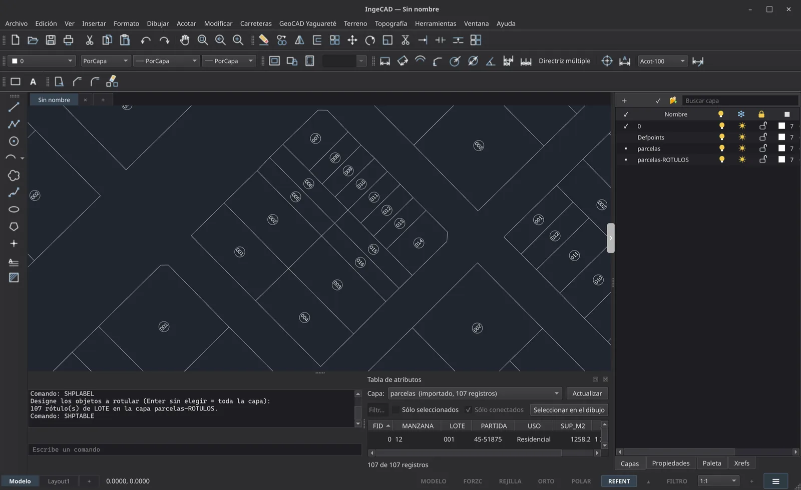

### ROTULOSIG: rótulos prolijos de una vez

**Para qué sirve:** rotular cada parcela con su partida, lote o titular, sin
escribir uno por uno.

**Paso a paso:**

1. **ROTULOSIG** y elegir la capa y el **campo**.
2. Elegir la **posición**: el **epicentro** del polígono o el **centro
   visual**; el texto sigue el **eje más largo**.
3. Opciones:
   - **Encerrar en un círculo** (al estilo de TCIRCLE de AutoCAD).
   - **Todos con la altura del más chico**, para que el plano quede parejo.
   - **Conservar los rótulos anteriores**, para sumar otro campo sin borrar
     lo hecho.
4. **Aceptar.**

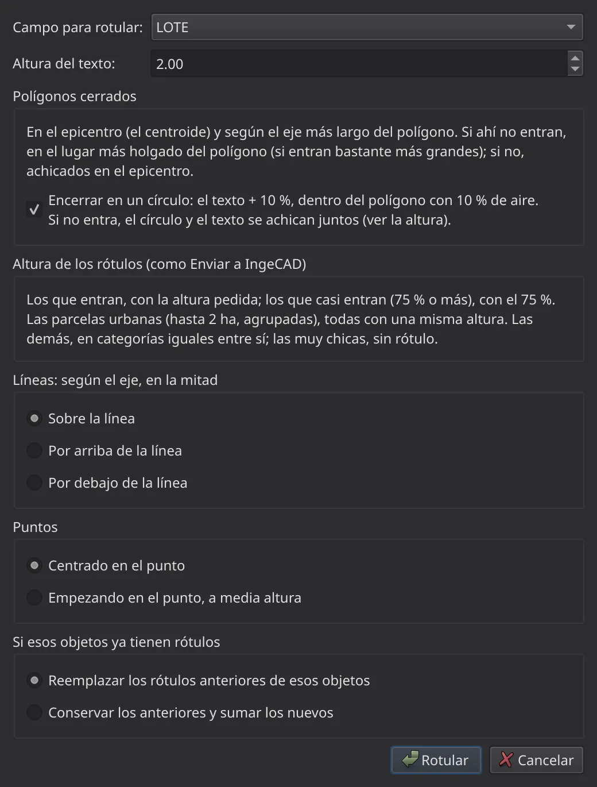

**Qué tiene que pasar:** cada parcela con su rótulo adentro. Los que no
entran se achican en el mismo lugar; con círculo, los achicados llevan
círculos iguales.

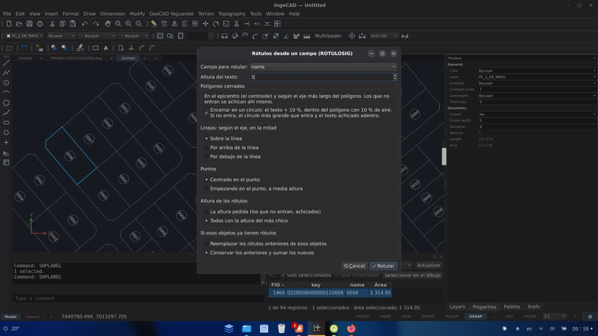

### Práctica 2.B — La manzana rotulada

Con la manzana traída con IMPORTARSHP (2.9) o enviada desde QGIS (Práctica
1.A):

1. **ROTULOSIG**, Enter sin elegir nada (toda la capa) → campo **LOTE**,
   altura **2**, **con círculo**. La línea de comandos dice «107 rótulo(s)
   de LOTE en la capa parcelas-ROTULOS».
2. **ROTULOSIG** otra vez → campo **PARTIDA**, conservar los anteriores.
3. **TEMATICO** → campo **USO**: cada parcela con el color de su uso.
4. **CONSULTASIG** → *SUP_M2 > 1000*: quedan elegidas las parcelas
   grandes (en la manzana 12, los lotes 001 a 004, de unos 1 250 m²).

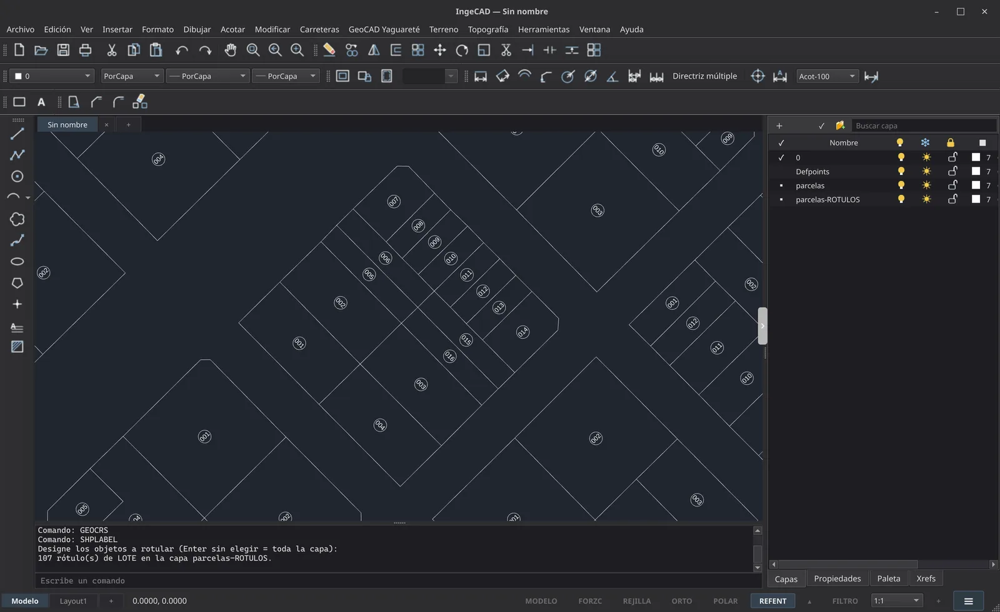

## 2.4 Dibujar y editar como en AutoCAD

Quien viene de AutoCAD encuentra lo mismo, con los mismos nombres.

| Qué | Cómo |
|---|---|
| **Botón derecho = Enter** | termina la orden, acepta lo escrito, repite la última; Ctrl + botón derecho abre el menú. Se prende y apaga con **BOTONDERECHO**. |
| **Ángulos relativos** | **ANGREL**: en LÍNEA y POLILÍNEA, `@d<ángulo` es el ángulo interior desde el tramo anterior, antihorario (180 = recto), como se mide en el terreno. |
| **Selección** | en cualquier «Designar objetos»: W, C, WP, CP, F, ALL, L, P, R, A, U y FI. **SEL** y **FILTRO** (FI) eligen por tipo, capa, color, medidas, textos y datos de QGIS. |
| **Empalme** (EMPALME / F) | también entre tramos de polilíneas, respetando el lado elegido. |
| **Chaflán** (CHAFLAN / CHA) | con **Ochava** por defecto (largo del bisel, ángulos iguales); Distancia, Ángulo, Polilínea, Múltiple. |
| **Partir en punto** (PARTEENPUNTO) | corta en un punto con referencias; muestra los dos pedazos antes del clic. |
| **Estirar** (ESTIRA / S) | con vista previa al instante. |
| **Igualar propiedades** (IGUALARPROP / MA) | origen resaltado; cada destino cambia a la vista; R y U los devuelven. |
| **Texto** (TEXTO / DT) | 1.er punto ubica, 2.º da la altura, 3.º la dirección. |
| **Agarres** | con un agarre tomado se escribe el punto (`@dx,dy`, `@d<ang`, distancia); Mayús + clic toma varios; Ctrl + clic en el medio agrega un vértice; Supr borra. |
| **Referencias** | Mayús + botón derecho abre el menú; Perpendicular y Apparent Intersection con guía punteada. |
| **Teclado** | lo que se escribe va a la línea de comandos esté donde esté el foco. |
| **Orden de dibujo** | **ALFRENTE** y **ALFONDO**; AutoCAD lo respeta al abrir el DXF. |
| **Propiedades en masa** | Ctrl+1 con muchos objetos: cambiar todos a la vez, largo y área totales. |
| **Pegar en el lugar** | **PEGARORIG** (Ctrl+Alt+V): pega con sus mismas coordenadas, capa y color; también lo copiado en QGIS. |

### Práctica 2.C — Una parcela por rumbos y una ochava

1. **ANGREL** prendido. **POLILÍNEA** desde el mojón: el primer tramo con su
   rumbo; los siguientes con `@distancia<ángulo interior` de la mensura
   (por ejemplo `@40<90`: 40 m a escuadra con el tramo anterior).
2. **CHAFLAN** en la esquina sobre la calle: Ochava, largo **4 m**.
3. **PARTEENPUNTO** en la intersección con la línea municipal.
4. **IGUALARPROP**: la parcela nueva toma capa y color de las vecinas.

## 2.5 Bloques

**Dónde está:** **GeoCAD Yaguareté > Bloques**.

- **BLOQUE**: los objetos se ven resaltados, el punto base se toma con
  referencias, con vista previa y confirmación.
- **INSERTAR**: el bloque sigue al cursor antes de ubicarlo.
- **Doble clic** sobre un bloque: se **edita en el lugar** (EDITARENSITIO),
  con **AGREGARABLOQUE**, **QUITARDEBLOQUE**, **GUARDARBLOQUE** o
  **DESCARTARBLOQUE**.
- **PUNTOBASEBLOQUE**: cambia el punto base sin mover lo dibujado.

## 2.6 Imágenes en el dibujo

### Formas de traer una imagen

| Orden | Para qué |
|---|---|
| **INSERTARGEO** | una imagen con archivo de mundo o GeoTIFF, **en su lugar** |
| **Ctrl+V** o **PEGARIMAGEN** | una captura de pantalla del portapapeles, con dos clics (esquinas inferiores) |
| **ABRIRGE** | la imagen de Google Earth, ya ubicada (capítulo 3) |
| **EXPORTARGEO** | guarda una copia con su archivo de mundo, que QGIS abre en su lugar |
| **ASPECTOIMAGEN** | fondo transparente, líneas en negativo o de un color, opacidad (en una copia: el original no se toca) |

### Tomar la imagen del marco

El marco de cada imagen se engancha con las referencias como en AutoCAD:
**Punto final** (esquinas), **Punto medio** (medio de cada lado),
**Inserción**, **Intersección**, **Cercano** y **Perpendicular**.

- **Ubicar**: DESPLAZA, punto base en una esquina del marco, segundo punto
  en el vértice del dibujo. La esquina queda exactamente ahí.
- **Escalar desde los extremos**: ESCALA con punto base en una esquina y
  Referencia de esquina a esquina del marco.
- **Girar o alinear**: GIRA con el punto base en una esquina del marco, o
  ALIGN con dos pares de puntos: la mueve, la gira y, si se quiere, la escala.
- **Recortar con los agarres** (en una copia): Ctrl en una esquina, en
  rectángulo; Ctrl en el medio de un lado, sólo ese lado; Alt + clic en un
  lado agrega una esquina. Hacia afuera, se vuelve a abrir.

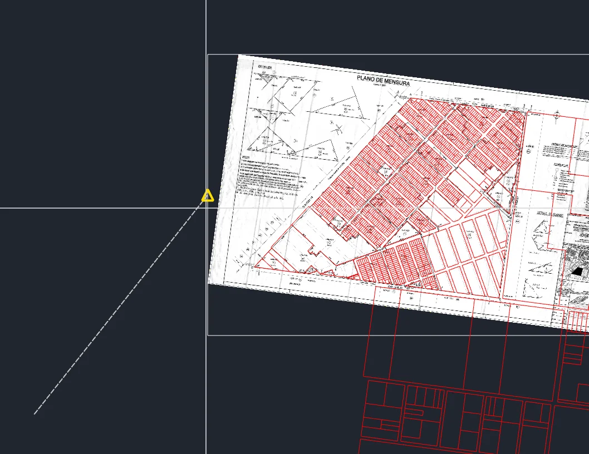

### GEORREF: un plano escaneado en su lugar

**Para qué sirve:** llevar un plano escaneado o una foto a su lugar marcando
pares de puntos, como el Georreferenciador de QGIS.

**Dónde está:** **GeoCAD Yaguareté > Ajustar imagen con puntos de control**
u orden **GEORREF**.

**Paso a paso:**

1. **GEORREF** y designar **una** imagen.
2. Marcar los pares: **punto en la imagen** (un vértice, un mojón, un cruce
   de calles) y **punto de destino**, el mismo en el dibujo. Cada par es una
   flecha numerada; con los pares suficientes se ve punteado dónde va a
   quedar. **U** quita el último punto.
3. **Enter** abre la **tabla de puntos**: residuo de cada par y **error
   medio**. Un par mal marcado salta a la vista: se apaga o se corrige.
4. Elegir el método y **Transformar**:

| Método | Pares mínimos | Cuándo |
|---|---|---|
| Lineal | 2 | mueve y escala X e Y por separado, sin girar |
| Helmert | 2 | mueve, gira y escala parejo (la más usada) |
| Polinómica 1, 2, 3 | 3, 6, 10 | afín; y planos con curvaturas o deformados |
| Thin Plate Spline | 3 | pasa exacto por cada punto (rubber sheet) |
| Proyectiva | 4 | fotos tomadas en perspectiva |

**Qué tiene que pasar:** el plano queda sobre las parcelas (con fondo
transparente si el método rehace la imagen). Los puntos quedan en un
**.points** que abre el Georreferenciador de QGIS, y QGIS abre la copia en su
lugar. Un solo **U** lo deja como estaba.

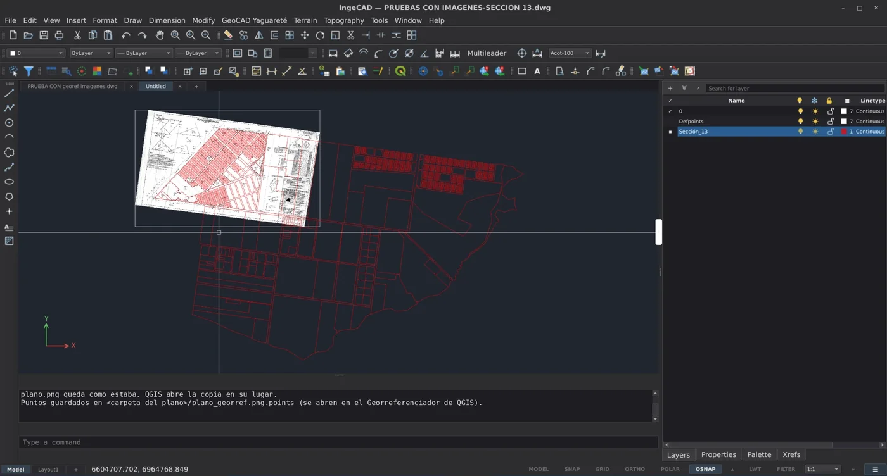

### Práctica 2.D — El plano viejo sobre la manzana

1. Traer el plano escaneado de 1980 (IMAGEATTACH, o Ctrl+V si es una
   captura) y llevarlo cerca tomándolo del marco.
2. **GEORREF**: cuatro pares en esquinas de manzana bien reconocibles.
3. En la tabla, **Helmert**: el error medio tiene que ser chico (decímetros).
   Si un par tiene un residuo grande, revisarlo.
4. **Transformar**, y **ASPECTOIMAGEN** → fondo transparente, líneas en
   rojo: se ven las diferencias con el parcelario actual.

## 2.7 Tablas

**PEGARTABLA**: pega lo copiado en una planilla (GenOffice, Calc, Excel) o
en la tabla de atributos de QGIS — reconoce de dónde viene — como **tabla**
con su formato (anchos, combinadas, colores, bordes), ubicada con dos puntos
que le dan la escala, en el modelo o en el papel; o como **dibujo y textos**
(la geometría de QGIS en su lugar, con rótulos).

## 2.8 La lámina: espacio papel, plumas y cotas

- **Espacio papel como AutoCAD**: la presentación respeta la escala de su
  configuración de página; con el dibujo en metros, una ventana a 1:100
  (1/100XP) muestra 100 m en 1000 mm y se imprime así.
- **VISTAPREVIA**: la presentación como sale impresa, con zoom e Imprimir.
- **PLUMAS**: la tabla de plumas .ctb como AutoCAD (color → color de
  impresión, grosor, tramado).
- **CREARCOTA**: un estilo de cota con escala del papel, letra, altura en mm
  de hoja y decimales («Acot-100-6mm»). Las cotas lineal, alineada y angular
  lo usan y caen en su capa.
- **Uniones de los grosores**: con LWT, las esquinas quedan en inglete.

## 2.9 Intercambio de archivos

| Orden | Para qué |
|---|---|
| **IMPORTARSHP** | uno o varios SHP, llevados al sistema del dibujo, con sus atributos en cada objeto |
| **EXPORTARSHP** | por capa y tipo, o por tipo con un campo LAYER, en el sistema del dibujo u otro, con .prj |
| **IMPORTARKML** / **EXPORTARKML** | de y hacia Google Earth (capítulo 3) |
| **Control de los DWG** | al guardar en DWG, las falsas alarmas conocidas de LibreDWG se descartan y lo que queda se explica en español |

### Práctica 2.0 — Traer la manzana con IMPORTARSHP

1. En un dibujo nuevo, **IMPORTARSHP** y elegir `datos_ejemplo/parcelas.shp`.
2. En la ventana: como el dibujo no tiene sistema, dejar tildado **adoptar
   el del primer SHP**; **Tildar todas** las columnas (MANZANA, LOTE,
   PARTIDA, USO, SUP_M2); una capa por archivo.
3. **Importar.**

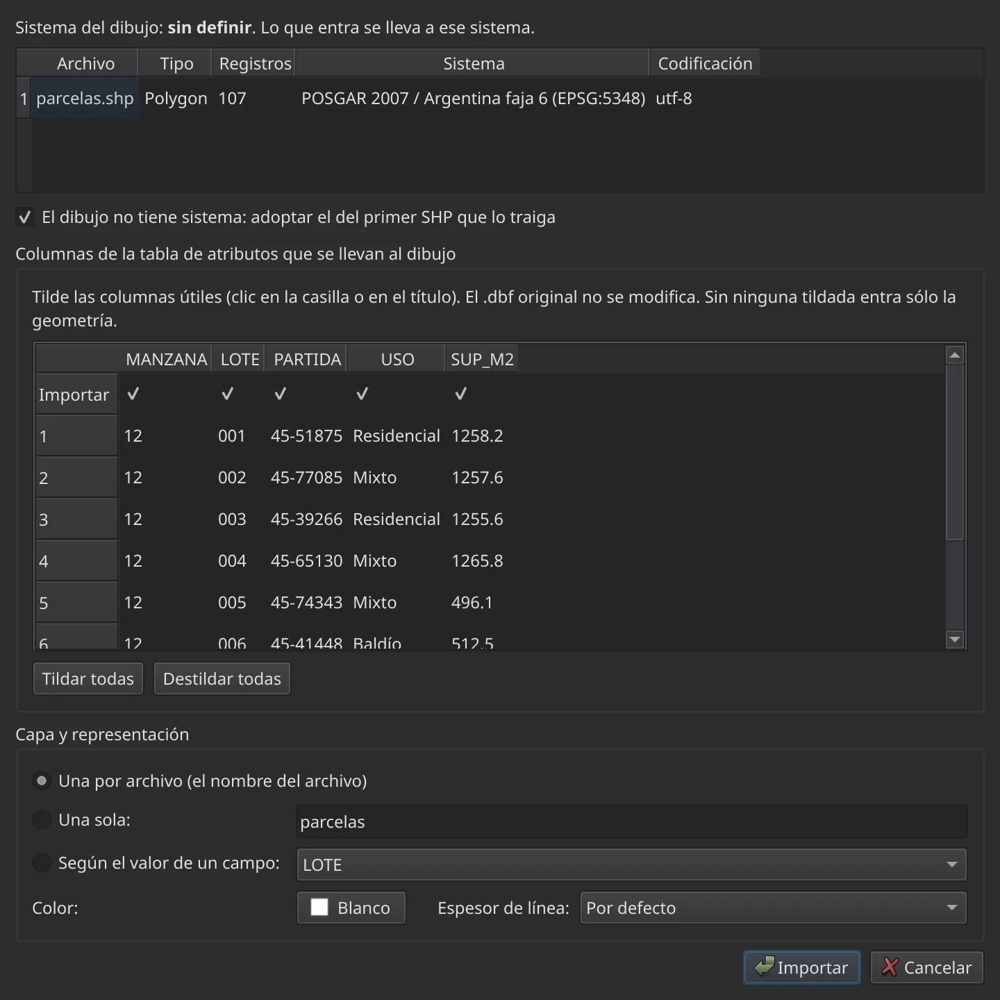

**Qué tiene que pasar:** la línea de comandos dice «Importado: 107
objeto(s) … El dibujo adoptó el sistema POSGAR 2007 / Argentina faja 6
(EPSG:5348)», y la tabla queda en TABLASIG, lista para ROTULOSIG.

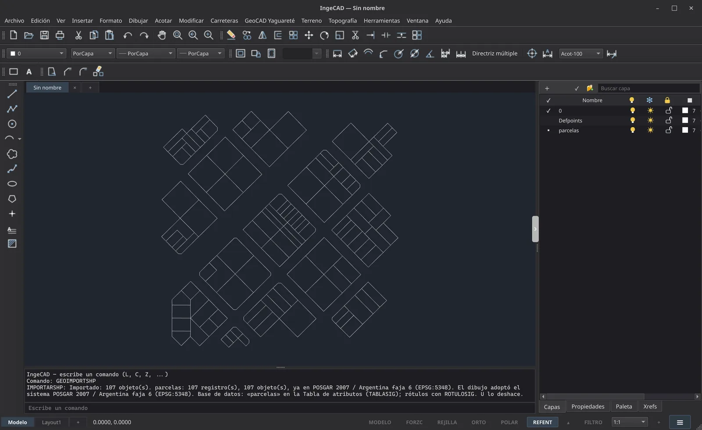

## 2.10 Mantener GeoCAD al día

- **GeoCAD Yaguareté > Actualizar GeoCAD Yaguareté (IngeCAD y QGIS)…**
  (ACTUALIZARGEOCAD): busca la versión nueva y la instala en los dos
  programas. Sólo ofrece versiones más nuevas que la instalada.
- **Diagnóstico de GeoCAD Yaguareté en esta computadora**
  (DIAGNOSTICOGEOCAD): un informe para adjuntar si algo no anda.
- **Acerca de GEO-CAD-YAGUARETÉ…** (ACERCAGEOCAD): la versión instalada.
