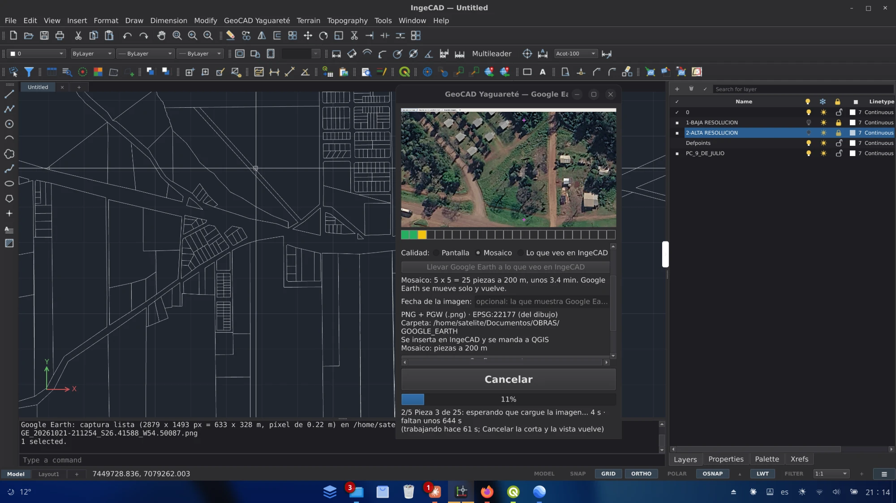
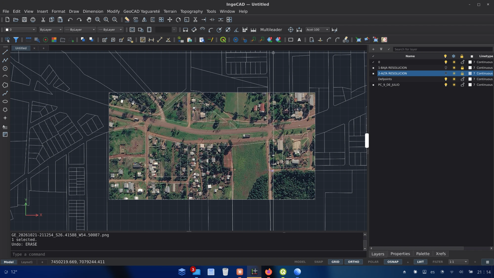
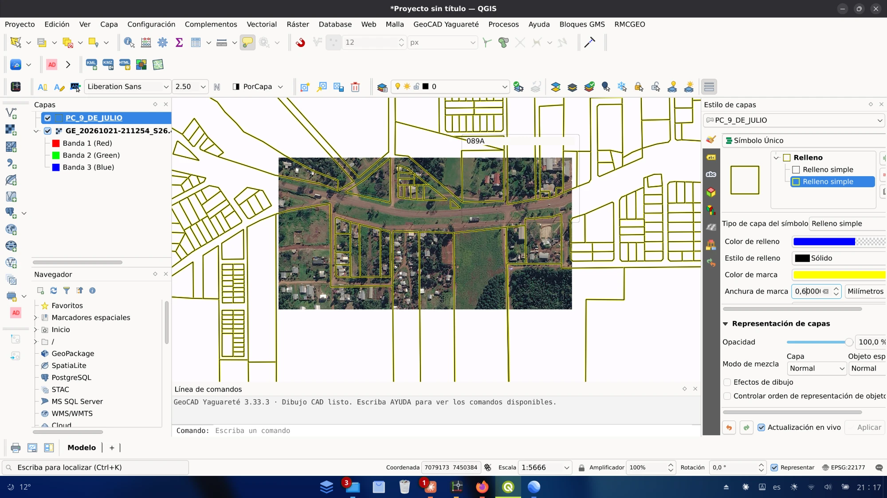
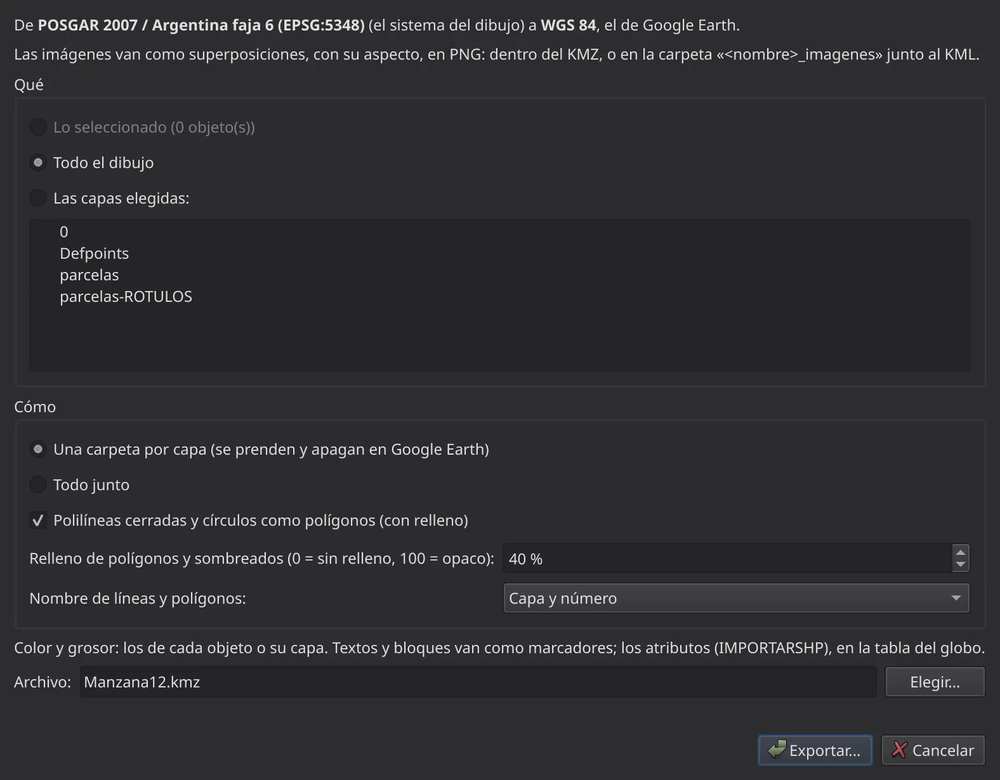

# Capítulo 3 — GeoCAD en Google Earth

## 3.1 Por qué Google Earth es la tercera frontera

Google Earth Pro es, para muchos trabajos, **el primer insumo geográfico**:
una imagen satelital de casi cualquier lugar del mundo, gratuita, con relieve
y con **imágenes históricas** para ver cómo estaba el lugar en otros años.
Sirve para un anteproyecto, para ubicar una mensura, para ver si un
alambrado se corrió o para mostrarle el trabajo a quien no usa programas
técnicos.

Su límite es que lo que se ve en pantalla es **una foto sin coordenadas**:
para usarla en un plano había que georreferenciarla a mano. Y al revés, para
mostrar un trabajo en Google Earth había que convertirlo a mano a KML.

GeoCAD resuelve los dos caminos:

| Camino | Qué se logra | Desde |
|---|---|---|
| **Google Earth → el dibujo** | la imagen entra **en su lugar y en su escala**, en el sistema del trabajo, en IngeCAD y en QGIS a la vez | IngeCAD o QGIS |
| **El dibujo → Google Earth** | el trabajo se ve sobre la imagen satelital, con sus colores, nombres y datos | IngeCAD o QGIS |
| **Google Earth → el dibujo (trazados)** | lo marcado en Google Earth (puntos, recorridos, polígonos) entra como dibujo con sus datos | IngeCAD |

> **Se necesitan los tres programas** instalados en la misma computadora:
> Google Earth Pro **de escritorio** (no la versión web), IngeCAD y QGIS, los
> dos con GeoCAD. Ver el capítulo final para instalarlos.

> 🪟 **En Windows** funciona todo este capítulo: la **captura de imágenes**
> (3.2 a 3.4) desde la versión **3.75.0**, y llevar y traer KML/KMZ (3.5 y
> 3.6) desde antes. Si con alguna placa de video la foto saliera negra,
> GeoCAD la saca de la pantalla: en ese caso hay que dejar Google Earth
> **a la vista** mientras captura.

## 3.2 Lo que GeoCAD pone dentro de Google Earth

GeoCAD no modifica Google Earth: se comunica con él por un **enlace de red**,
una herramienta que el propio Google Earth trae para recibir datos de otro
programa.

- Al abrir Google Earth con GeoCAD aparece en **Lugares temporales** un
  enlace llamado **«GeoCAD Yaguareté»**, con tres partes:
  - **Vista**: por ahí GeoCAD lleva Google Earth a un lugar y sabe qué se
    está viendo.
  - **Cámara**: endereza la vista (a plomo, con el norte arriba) para la
    captura.
  - **Cruces**: las cuatro cruces magenta de control que ubican la imagen.
- ⚠ **Tiene que haber uno solo.** No guardarlo en *Mis lugares*; si quedó
  alguno de una vez anterior, borrarlo. La ventanita de GeoCAD avisa si el
  enlace es viejo.

La **ventanita de GeoCAD** es el tablero de control: arriba muestra
**Google Earth en video** (sólo el mapa, sin paneles: exactamente lo que se
va a capturar), y abajo los botones, la calidad y la lista «Listo para
capturar».

## 3.3 Preparar todo (una sola vez)

1. **Activar el módulo**: **GeoCAD Yaguareté > Módulos… > Google Earth**,
   en IngeCAD y en QGIS.
2. **Decirle al dibujo en qué sistema está.**
   - En IngeCAD: orden **SISTEMAGEO** (por ejemplo, POSGAR 2007, faja 7).
   - En QGIS: el proyecto en coordenadas planas (*Proyecto > Propiedades >
     SRC*).
3. **Velocidad de vuelo al máximo.** En Google Earth: **Herramientas >
   Opciones > Navegación > Velocidad de vuelo**, en **5**, y **Aceptar**. De
   fábrica viene en 0,18: cada pieza de un mosaico tarda unos 45 segundos;
   con 5, unos 10 (un mosaico de 25 piezas: 4 minutos en vez de 25). GeoCAD
   no puede cambiarla solo; si vuela lento, lo avisa.
4. **Si Google Earth es Flatpak** y dice que *no puede acceder a la ubicación
   del archivo de caché*, ver el capítulo final (permisos de Flatpak).

## 3.4 Capturar imágenes ubicadas

**Para qué sirve:** tener la imagen satelital debajo del dibujo, en su lugar
exacto, sin georreferenciar a mano.

**Dónde está:**

| | IngeCAD | QGIS |
|---|---|---|
| Abrir Google Earth con GeoCAD | GeoCAD Yaguareté > Google Earth, u orden **ABRIRGE** | GeoCAD Yaguareté > Google Earth |
| Capturar | botón **CAPTURAR**, **Ctrl+Alt+G** u orden **CAPTURARGE** | botón **CAPTURAR** o **Ctrl+Alt+G** |
| Configurar captura | **CONFIGURARGE** | Configurar captura… |
| Este capítulo del manual | Manual de Google Earth (capítulo 3)… (**MANUALGE**) | Manual de Google Earth (capítulo 3)… |

**Paso a paso:**

1. **Abrir Google Earth con GeoCAD.** Se abre la ventanita y Google Earth
   con el enlace «GeoCAD Yaguareté». Si Google Earth ya estaba abierto, lo
   enlaza.
2. **Llevar Google Earth a la zona**: moverlo a mano o tocar **«Llevar Google
   Earth a lo que veo en IngeCAD/QGIS»**. Google Earth vuela hasta lo que se
   ve en la pantalla del programa.
3. **Elegir la fecha** de la imagen, si interesa: en Google Earth, el reloj
   de *imágenes históricas*. GeoCAD captura la que esté puesta.
4. **Elegir la calidad:**
   - **Pantalla**: lo que se ve ahora en Google Earth, de una vez (unos
     segundos). Con la ventana de Google Earth más grande sale con más
     detalle.
   - **Mosaico**: varias fotos más de cerca, unidas en **una** imagen con
     mucho más detalle (hasta 25 piezas). Si la vista está muy alta, GeoCAD
     sube solo la altura de las piezas para que entren en 25.
   - **Lo que veo en IngeCAD/QGIS**: un mosaico de exactamente la zona que
     se ve en la pantalla del programa.
5. **Revisar «Listo para capturar»**: enlace, vista, sistema y carpeta, todo
   en verde. Lo que está en rojo dice qué hacer.
6. **CAPTURAR** (o **Ctrl+Alt+G**).

**Mientras captura:**

- ⚠ **No mover, tapar ni minimizar Google Earth**: la foto es de su ventana.
- La vista se endereza sola y aparecen **cuatro cruces magenta**. La
  chincheta del buscador o la brújula pueden tapar una: borrar la chincheta
  y, si hace falta, apagar la brújula (**Ver > Brújula**).
- La **barra de fotogramas** muestra el avance: **verde** las piezas listas,
  **amarillo** la que se está haciendo, **rojo** las que hay que repetir.
- Si algo falla, GeoCAD **vuelve a intentar solo**; si una pieza no sale
  ni al final, entrega el mosaico con ese hueco en blanco y avisa cuál.
- **Cancelar** corta la captura y Google Earth vuelve a donde estaba.

**Qué tiene que pasar:**

- Google Earth vuelve a la vista de antes.
- La imagen aparece **en su lugar** en el dibujo de IngeCAD (con **U** se
  quita) y llega **como capa a QGIS** por el Puente (o al revés, si se
  capturó desde QGIS). 🔁
- En la carpeta de capturas queda el archivo con un nombre que dice cuándo y
  dónde se sacó, por ejemplo
  `GE_20261021-093512_S27.09633_W54.88868_img-9-7-2023.png`, más su archivo
  de ubicación (.pgw, .jgw o .tfw), su .prj y un .txt con el detalle
  (tamaño del píxel, control de las cruces, costuras del mosaico).

**Configurar captura** permite elegir: formato (GeoTIFF, PNG o JPG), calidad,
altura de las piezas del mosaico, sistema (el del dibujo u otro), carpeta (la
misma para IngeCAD y QGIS), qué hacer después (insertar, mandar al otro
programa) y si las cruces se muestran siempre.

> 💡 Capturar desde **un programa por vez**: la imagen llega igual al otro.

### Práctica 3.A — La manzana antes y ahora

1. Con la manzana del caso práctico abierta en IngeCAD, **ABRIRGE** y
   **«Llevar Google Earth a lo que veo en IngeCAD»**.
2. En Google Earth, en *imágenes históricas*, elegir una imagen de hace
   diez años. Calidad **Lo que veo en IngeCAD**. **CAPTURAR**.
3. Volver la fecha a la más reciente y capturar otra vez.
4. En IngeCAD, prender y apagar las dos imágenes debajo de las parcelas:
   se ve qué se construyó y qué alambrado se corrió. En QGIS llegaron las
   mismas dos capas.

## 3.5 Llevar el trabajo a Google Earth (KML / KMZ)

**Para qué sirve:** mostrar el dibujo o las capas sobre la imagen satelital,
a cualquiera que tenga Google Earth: un cliente, un vecino, un juzgado, un
municipio. El KMZ se abre con doble clic.

### Desde IngeCAD: EXPORTARKML

**Dónde está:** **GeoCAD Yaguareté > Exportar > KML / KMZ…**, el botón del
globo con chinche de la barra GeoCAD, o la orden **EXPORTARKML**.

**Paso a paso:**

1. **EXPORTARKML.** Si el dibujo no tiene sistema, lo pregunta (la misma
   ventana de SISTEMAGEO) y lo deja asignado.
2. **Qué** exportar: lo seleccionado, las capas elegidas o todo el dibujo.
3. **Cómo**: una carpeta por capa (se prenden y apagan en Google Earth) o
   todo junto.
4. **Relleno** de los polígonos: semitransparente, el porcentaje se elige
   (40 % si no se dice; 0 = sin relleno).
5. **Nombre** de líneas y polígonos: «capa y número» o un atributo de la
   tabla (por ejemplo, la partida).
6. **Archivo**: KMZ (recomendado) o KML.

**Qué tiene que pasar:**

- Cada objeto en Google Earth con **el color y el grosor** del dibujo (el
  blanco/negro de CAD sale blanco, que se ve sobre la imagen).
- Arcos y círculos en tramos de 1 cm; textos como rótulos; bloques y puntos
  como marcadores.
- Al hacer clic en un objeto, **el globo muestra sus datos**: los atributos
  de la capa, su capa y su largo, o su área y perímetro.
- El dibujo no se mueve ni se cambia. Si el archivo ya existía, pregunta
  antes de reemplazarlo.

### Desde QGIS: Exportar a Google Earth y Ver en Google Earth

**Dónde están:** en **Administrar Herramientas**, módulo Google Earth (no
van en el menú GeoCAD). Desde ahí se ponen en la barra.

- **Exportar a Google Earth (KML/KMZ)…**: se eligen las capas (de entrada,
  las visibles), el archivo y si se abre al terminar.
- **Ver en Google Earth**: un clic. Manda las capas visibles a Google Earth
  sin preguntar el archivo.

**Qué tiene que pasar:**

- Una carpeta por capa, con el grupo en el nombre («Obra - Calles»).
- **Color, grosor, relleno y opacidad como los dibuja QGIS**: símbolo único,
  categorizado, graduado, por expresión y por reglas.
- Nombre de cada objeto: el rótulo de la capa o un campo «nombre». Todos los
  atributos en el globo.
- Lo que no se pudo exportar se informa con el motivo. Si algo falla, el
  archivo anterior queda como estaba.

### El control del sistema de coordenadas

El error más común al llevar un trabajo a Google Earth es que aparezca **a
cientos de kilómetros**: la capa dice una faja y sus coordenadas son de otra.
GeoCAD lo controla antes de exportar, en IngeCAD y en QGIS:

- **Capa sin sistema**: pregunta y propone la faja según las coordenadas.
- **Coordenadas de otra faja que la declarada**: avisa y ofrece corregir.
- Lo que se elige vale sólo para esa exportación: la capa no se toca.
- Si la conversión es poco precisa (por ejemplo, desde Campo Inchauspe, unos
  9 m), lo dice el aviso final.

### Práctica 3.B — El KMZ para el cliente

1. En IngeCAD, con la manzana del ejemplo, seleccionar el **lote 006 de la
   manzana 12** y sus linderos (005 y 007).
2. **EXPORTARKML** → *lo seleccionado*, una carpeta por capa, nombre = el
   atributo **PARTIDA**, relleno 30 %, archivo `Lote006.kmz`.
3. Abrir el KMZ con doble clic: Google Earth vuela a la parcela. Hacer clic
   en ella y ver la tabla con sus datos.
4. Mandar el KMZ por correo: el cliente lo abre con Google Earth, sin otro
   programa.

## 3.6 Traer de Google Earth: IMPORTARKML (IngeCAD)

**Para qué sirve:** aprovechar lo que alguien marcó en Google Earth — un
recorrido de GPS, puntos de un relevamiento rápido, un polígono dibujado
sobre la imagen — o un KML/KMZ recibido de otro organismo.

**Dónde está:** **GeoCAD Yaguareté > Importar > KML / KMZ…**, el botón del
globo con la flecha hacia adentro, o la orden **IMPORTARKML**.

**Paso a paso:**

1. En Google Earth, guardar lo marcado: clic derecho sobre la carpeta o el
   lugar > **Guardar lugar como…** > KMZ.
2. En IngeCAD, **IMPORTARKML** y elegir el archivo.
3. Si el dibujo no tiene sistema, GeoCAD **propone uno según dónde cae el
   KML** (POSGAR 2007 en la faja de su longitud; fuera de la Argentina, el
   UTM de WGS 84). El marco se elige.
4. Elegir: **cada carpeta a una capa** o todo en una capa; y si el nombre de
   cada marcador entra como **rótulo** (con su altura).

**Qué tiene que pasar:**

- Puntos como puntos; líneas y recorridos como polilíneas; polígonos como
  polilíneas cerradas (cada hueco, otra).
- Los colores de Google Earth se conservan.
- Los datos de cada marcador quedan como **atributos** (se ven con
  TABLASIG), igual que con IMPORTARSHP.
- Todo es un solo paso: **U** lo deshace.
- No se importan imágenes superpuestas, vínculos de red ni modelos 3D, y la
  altura (Z) queda en 0. La línea de comandos dice cuántos se saltearon.

> 💡 **Ida y vuelta:** lo exportado con EXPORTARKML vuelve con IMPORTARKML al
> mismo lugar (diferencia máxima medida: 0,06 mm), con sus capas, colores,
> textos y atributos.

## 3.7 Si algo no anda

| Lo que pasa | Qué hacer |
|---|---|
| «Google Earth con el enlace de antes» | En Google Earth, borrar todos los «GeoCAD Yaguareté» (Lugares temporales y Mis lugares) y volver a **Abrir Google Earth con GeoCAD**. |
| «Se cortó el enlace» | Google Earth se cerró o dejó de pedir el enlace: abrirlo de nuevo con GeoCAD. |
| No se ve una cruz | Algo la tapa: la chincheta del buscador, la brújula u otra ventana. |
| El mosaico tarda mucho, o «Google Earth vuela lento» | Velocidad de vuelo en 5 (ver 3.3). |
| «Google Earth no está a la vista» | Está minimizado o cerrado: traerlo al frente o abrirlo con GeoCAD. |
| «Another instance of this application is already running» sin otro abierto | Quedó trabado por un cierre de golpe. **Abrir Google Earth con GeoCAD** lo destraba solo (si no hay ninguna ventana de Google Earth, ni minimizada). A mano: borrar `~/.googleearth/instance-running-lock`. |
| El trabajo aparece lejos, en otra provincia o en el mar | El sistema de la capa no es el de sus coordenadas: aceptar la corrección que ofrece GeoCAD o revisar SISTEMAGEO. |
| En Windows, la captura no anda | Hace falta GeoCAD 3.75.0 o más nuevo (ver 3.1). Dejar Google Earth a la vista mientras captura. |
| «Ctrl+Alt+G sólo con esta ventana al frente (otro programa ya usa Ctrl+Alt+G)» | Otro programa tomó ese atajo: capturar con el botón de la ventanita. |
| Hay que reportar un problema | Lo que pasa entre GeoCAD y Google Earth queda en `~/.config/geocad/googleearth_registro.txt` (en Windows, `%USERPROFILE%\.config\geocad\googleearth_registro.txt`): adjuntarlo en [Issues](https://github.com/archibello/GEO-CAD-YAGUARETE/issues). |

## 3.8 Condiciones de uso de las imágenes

Las imágenes de Google Earth tienen las **condiciones de uso de Google**:
sirven como referencia para el trabajo y hay que **respetar su atribución**
cuando se muestran o se imprimen. No reemplazan a una mensura ni a una
imagen con valor legal.
